# TownReporter — editor’s manual

**Current software version: [0.6.85](releases/0.6.85.md).** This guide is for a running newsroom with an editor account, in the order you use it. The release guide separates source, package metadata, GitHub publication, deployment and provider-run evidence. Operators should start at [setup](setup.md). The whole system, including how it is built, is the [manual](manual.md); [Part 2](manual.md#part-2--the-desk-screen-by-screen) is the screen-by-screen tour of the same desk. A one-page version is [editor-desk.md](editor-desk.md). The contract for the Dark Desk screen is [dark-desk-editor.md](dark-desk-editor.md), and its doctrine is [dark-desk.md](dark-desk.md).

The screenshots in this guide were taken from the running 0.6.84 desk and public paper. If a label ever differs from a picture, the words in the text and on screen are right.

**Three rules that run through the whole desk.**

1. **Nothing prints until a person says so.** Scan does not publish. Draft does not publish. Dark Desk does not publish. **Publish** on the story page is the gate for ordinary reporting. Approved routine notices (like “Today in town”) use their own fixed-template path, which the owner turns on.
2. **The app warns; it never blocks.** When something looks risky you get a warning and an “anyway” button that names the action, such as **Publish anyway in <Section>** or **Kill anyway**. Cancel changes nothing. Every “anyway” is recorded with your name. (A few true impossibilities, such as publishing an empty story, do stop.)
3. **One model picker everywhere.** Every AI button uses the same list of models, with **Automatic** as the default. See [Models](#models).

---

## Two rooms

The **paper** (`/`) is what the public reads: published stories, About, How we report, Corrections, RSS. Ordinary reporting reaches it through your review and publication; approved sources can produce automatic roundups of routine notices through fixed templates.

The **desk** (`/desk`) is the newsroom: Today, Queue, Drafts, Published, Opinion, Follow-ups, Dark Desk, Sources & scan, Models, Server and Stats. Sign-in required.

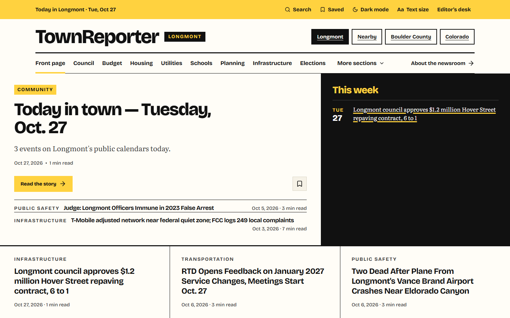

A draft, a reporting note, a research memo, a Dark Desk file: none of that is the paper. If you see notebook language on the paper (“What is solid,” “Next checks are…”), something went wrong; it is supposed to be stripped. Tell the operator.

---

## A working day

This is the loop. Skip steps that have nothing in them.

1. **Today** — read **Tonight’s edition** and **In progress** for stories waiting on you, glance at **Running now**, and look at **New leads**. The four-step strip (**Pick leads**, **Draft**, **Check**, **Publish**) shows where work is waiting.
2. **Sources & scan** — is the watch list still the right list? Press **Run scan now** (on Today, the Queue or Sources & scan). It files leads. This is the expensive click.
3. **Queue** — read what came in. **Start story**, **Hold**, **Kill**.
4. **Story page** — draft, read, check against the documents, run **Check draft against evidence**, then publish or don’t.
5. **Drafts** — everything not yet printed, one row per story, with its status.
6. **Dark Desk** — only when something doesn’t add up, disappeared, or was never posted.
7. **Opinion** — when the paper should say what it thinks about something it has reported.
8. **Published** — if you got it wrong, post a correction, and fix the story text too when the words themselves were wrong. Both are public.
9. **Server** and **Models** — a glance when something feels slow or a login has lapsed.

---

## Sign in and first run

Anyone can read the paper. Only signed-in editors can open the desk.

**To claim a new desk (the first person in becomes the owner):**

1. Open the public paper. At the bottom of the page, in the **The newsroom** column, press **Create editor**. The button shows only while nobody owns the desk.
2. On the sign-in page, fill in **Name**, **Email**, **Password** (at least 8 characters), **Confirm password** and **Setup code**. The setup code is printed once when TownReporter is installed, in the server log and in the data folder's `logs/SETUP-CODE.txt`.
3. Press **Create editor account**.
4. The desk opens on **Set up the paper** (next section).

If the setup code is wrong, the account is still made and you stay signed in. Fix the code and press the button again. After five wrong codes in 15 minutes the page asks you to wait.

**To sign in later:** press **Editor’s desk** at the top or bottom of the public paper, or go to `/desk`. Enter your email and password and press **Sign in with email**. After ten wrong passwords for one email the account locks for 15 minutes.

**To join as a second editor:** the owner makes a one-time link under **Server → Editors & access → Invite an editor** and sends it to you. Open it, choose a password and you are in. The link works once, only for the invited address, and expires after seven days. Invited people are editors, never owners, and do not need a setup code.

**If you lose your password:** on the sign-in page press **Lost your password? Use a recovery code**, type an unused code and press **Use this code**. You get a one-time temporary password to sign in with. The owner makes recovery codes ahead of time on **Server → Editors & access**. There is no email reset link.

**To sign out,** use **Sign out** in the footer of the public paper, next to your name. The desk itself has no Sign out button, on purpose.

**To hand the desk over:** **Server → Editors & access → Give up the desk**. It asks you to type your email address first. For the owner it frees the newsroom for the next person with the setup code; the paper stays. For an invited editor it removes only that editor’s own seat. You cannot take it back.

---

## Set up the paper

`/desk/setup` — the first screen after the owner creates a new desk. Only the owner sees it.

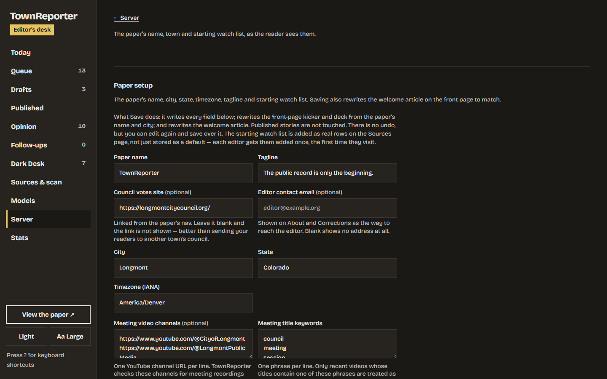

**To set up the paper:**

1. Fill in **Paper name**, **City**, **State** and **Timezone (IANA)**. These four are required. The timezone box starts with your browser’s zone, for example `America/Denver`.
2. Optional: **Tagline**, **Council votes site** (a link shown in the paper’s navigation; leave it blank rather than point readers at another town), **Editor contact email** (shown on About and Corrections; blank shows no address), **Elected officials and staff** (one name and title per line).
3. **Meeting video channels**: one YouTube channel URL per line. **Meeting title keywords**: the phrases that mark council, board and commission recordings, one per line.
4. **Starting watch list**: add rows of **URL** and **Title** (**Add another**, **Remove**). These become your first sources.
5. Press **Save and open the desk**.

Saving writes the choices to the database, sets the front-page kicker, adds the watch list as sources, rewrites the welcome article for your city and opens the desk. Until the owner saves, the public paper shows “Not yet set up”. Every choice can be changed later on **Server → Paper setup**. No code edit or rebuild is needed. The setup form can only be used once; opening `/desk/setup` on a finished paper sends you back to Today.

If a local model program (LM Studio or Ollama) is running with nothing loaded when you finish, Today shows a **Choose your writing model** card to the owner. See [Models](#models).

---

## Getting around the desk

Every desk screen has the same frame: a navigation column on the left and the work area on the right.

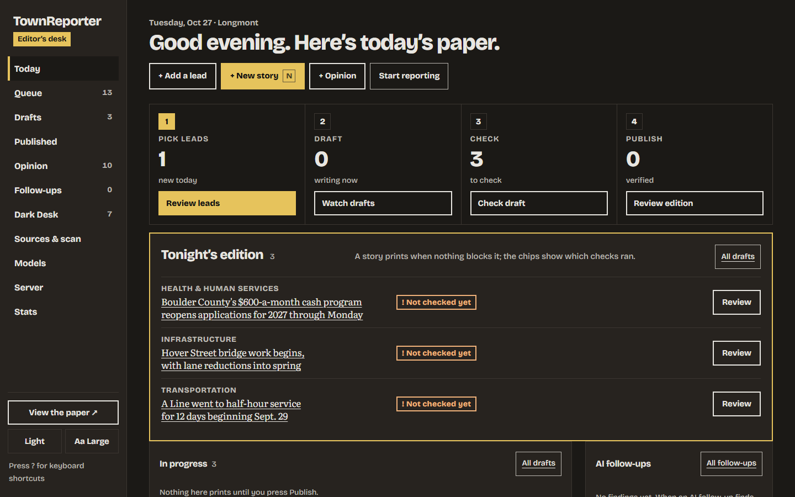

### The navigation

Top to bottom: **TownReporter / Editor’s desk** (a link to the public paper), the **Running** box when something is running, then eleven links:

| Link | What it is | Number beside it |
|---|---|---|
| **Today** | The home screen | none |
| **Queue** | Every lead | Open leads |
| **Drafts** | Stories being written or waiting for checks | Rows on the Drafts screen |
| **Published** | What is live, and corrections | none |
| **Opinion** | Editorials | Requests and editorials |
| **Follow-ups** | AI agents watching for answers | Active follow-ups |
| **Dark Desk** | Open-ended investigations | Files on the desk |
| **Sources & scan** | The watch list and the scan | none |
| **Models** | Which AI does which job | none |
| **Server** | Owner settings and health | none |
| **Stats** | Anonymous reader counts | none |

A number shows only once it has loaded, never a made-up zero. The footer has **View the paper ↗**, a **Dark / Light** button, an **Aa Large / Aa Normal** button, and **Press ? for keyboard shortcuts**. A button’s label names what pressing it gives you: it reads **Dark** while the desk is light.

Four screens are not in the navigation but are reachable: **Scan history** (button on Sources & scan), **Import** (see [Import finished stories](#import-finished-stories)), **Beat memory** (the bottom of Published) and **Legal removals** (owner only; linked from Published). All four are also found with search.

**On a phone** the navigation is a drawer. The top bar has **Menu**, the **TownReporter** name (a link to the paper) and **+ New**. The drawer holds the same links and buttons.

### Look and text size

**Dark / Light** and **Aa Large / Aa Normal** are kept in your browser. A browser that never chose starts Dark with normal text. Large text makes everything on the desk 20 percent bigger. The Dark Desk screen follows the same choice. These settings do not follow you to another browser.

### The Running box

While anything is running or waiting, the navigation shows **Running · N** (and **· 3 queued** when jobs are waiting). Each row is a small card: what is running, the model, a clock, **Now:** with the current step, **Last activity** and **Cancel**. Press the heading to go to Today. Scans, drafts, evidence checks, Dark Desk digs, editorials, routine editions and reporting runs all show here.

If a card sees no news from its worker for 60 seconds it says **No activity for m:ss. The model may be slow, or it may have stalled.** and offers **Keep waiting** and, when possible, **Retry on next model**. A stopped card offers **Retry** and **Retry on another model**. A waiting draft offers **Run it on another model**.

### Find a story or screen

Press **Ctrl+K** (**Cmd+K** on a Mac) on any desk screen. The box **Search your newsroom** lists screens, leads (by headline, topic or why-line) and Opinion pieces as you type. Pick one to go there. This search looks only at titles and topics. It does not read story text. Searching by meaning is on the story page; see [Find evidence](#find-evidence). There is no search button on screen, so a phone without a keyboard cannot open this box.

### Keyboard shortcuts

Press **?** (when you are not typing) to open the list. On **Today** and **Queue** these keys work on the highlighted lead: **J / K** next or previous, **S** start a story, **H** hold, **X** kill, **U** undo, **Enter** open. **N** starts a new story. **Ctrl+S** (**⌘S**) saves in the story workbench. **Esc** closes a list or the phone menu. Keys are ignored while you type in a box.

### The app warns; it never blocks

When something looks risky, TownReporter says so and lets you go ahead. The warning appears in one of two ways, and both end with a button that names the action plus the word “anyway”:

- A box titled **Before you continue** with a sentence and two buttons: **Cancel**, and the “anyway” button, for example **Draft this story anyway**, **Run anyway** (for hourly limits and scans), **Check anyway**, or **Stop and restart with <model>**.
- A message at the corner of the screen that stays until you press its button: **Kill anyway**, **Hold anyway**, **Release anyway**, **Reopen anyway**.

Every “anyway” you press is saved in an audit record with your name. Pressing **Cancel** changes nothing. The same rule runs through Publish; see [Publish](#publish).

### Messages and undo

Every press ends with a short message at the bottom left of the screen (top left on a phone). Successes stay about five seconds, failures twelve, and the Kill strip eight. On a phone the Kill strip leaves a 16 px gap on each side. Kill, Hold and Release messages carry **Undo**.

---

## The desk

`/desk` — **Today**. What to do next, what is running, and the best new leads.

Read it top to bottom:

1. **The greeting.** “Good morning. Here’s today’s paper.” (or afternoon, evening, by the paper’s clock), with the date and city above it. Buttons: **+ Add a lead**, **+ New story**, **+ Opinion** and **Start reporting**.
2. **Choose your writing model** (owner only, first run only). Appears when a local model program answered with nothing loaded. Press **Use <model>** next to a local model or **Keep the Automatic ladder**.
3. **Today’s work.** Four cells: **Pick leads** (new today, button **Review leads**), **Draft** (writing now, **Watch drafts**), **Check** (drafts waiting on you, **Check draft**) and **Publish** (drafts ready, **Review edition**). The numbered square of the next step that has work is yellow.
4. **Running now.** Cards for what is running, each with **Cancel** and an open button such as **Open your story** or **Open the scan**.
5. **Tonight’s edition.** Stories that are through writing. Each row has the section, the headline and one chip: **✓ Ready**, **✓ Verified**, **! N to check**, **! Not checked yet**, **✕ Not ready**, **… Checking facts**, or **Writing · 2:18** / **Queued**. The button changes with the state: **Watch**, **Retry**, **Check**, **Continue**, **Start story**, **Review**. A story prints only when you press Publish on its page; this list prints nothing.
6. **In progress.** Up to five stories you have started, each with **View progress** or **Open draft**. Nothing here prints until you press Publish.
7. **New leads.** The best leads from the last finished scan, best first. Two buttons switch between **Open · N** and **Held · N**. Each row shows a score out of 20, chips, the headline, the why-line, evidence squares, the section and age. Buttons: **Start story** (S), **Hold** (H), **Kill** (X). A **Model for Start story** picker sits above the list. Kill shows one line, **Lead killed.**, with **Undo** for 8 seconds. Hold shows a message with **Undo**. A held lead shows **Release**; a killed lead shows **Undo**. **All leads in the Queue →** goes to the Queue.
8. **The right rail.**
   - **AI follow-ups**: the latest findings, with **Review finding** and **All follow-ups**.
   - **Dark Desk**: counts of **Open files**, **Signals to review** and **Waiting on an AI follow-up**, and **Open Dark Desk →**.
   - **The wire**: one line per watched source (problems first), **Run scan now**, **All sources**, a **Model for this scan** picker, and a **More from the wire** list with the last scan, source health, suggested sources (**Accept** or **Drop**) and recent published stories.

Today has no “Needs you” panel. Look at Tonight’s edition and In progress for work waiting on you.

**Today in town.** Besides stories you write, the paper can print routine roundups on its own. The owner switches this on under **Server → Routine notices**. Each day the desk reads approved public calendars and prints a fixed-format story headed, for example, “Today in town — Sunday, Oct. 25”, with one block per event in time order (and **Morning**, **Afternoon**, **Evening** headings when there are six or more), then a “Source:” link. A Friday “This weekend” and a “Deadlines approaching” edition work the same way. You will see **Filing the routine edition** in the Running box while one is made, and the printed story under **Published**. These roundups come from approved sources through fixed templates, not from a model, so there is nothing to review before they print. If something in a source looks risky (a cancelled event, an unclear date), the desk leaves it out and counts it as needing review; the owner reads the reasons on the Server page.

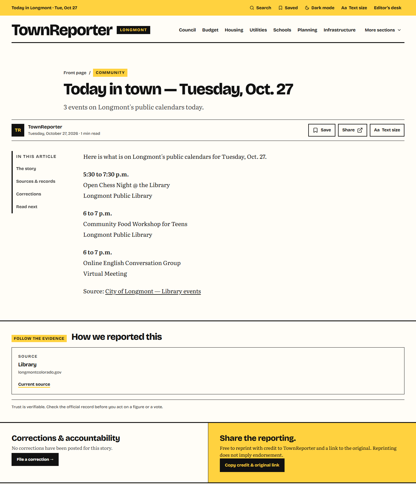

---

## Start a story or add a lead

### New story

`+ New story` on Today, the **N** key, or **+ New** on a phone opens a dialog with three tabs. Nothing prints until you press Publish.

**AI drafts from material** — to have the AI write from your sources:

1. Drop files on **Drop documents here** or press **Choose files**. The desk reads PDF, Word, Excel, PowerPoint, LibreOffice, text, images (with OCR), CSV and subtitle files: up to 20 files, 100 MB each.
2. Paste web, PDF or YouTube addresses into **Links**, or paste text into **Source text**.
3. Say what you want in **Assignment**: the angle, what to find out, what to ignore.
4. Choose **Research scope**: **Research public sources** (follows your links and searches for public evidence) or **Use only supplied material** (reads your text and files only; no searching).
5. Choose a **Model** (see [Models](#models)).
6. Press **Start drafting**. The dialog stays open and says the draft is under **Running now**; it will land in **Drafts**.

**Write it myself** — to write your own: fill in **Headline**, **Summary**, **Story**, **Section** and, if you have them, **Sources**. Press **Save draft**, or **Save & check against evidence** to run the evidence check as well. The section must be chosen (“Section not chosen — pick one”) and you still confirm it at Publish.

**Paste a finished story** — for a story written elsewhere: fill in **Original link**, **Credit line**, **Story text** and **Section**, then choose what the AI should do: **Nothing: keep it exactly as pasted**, **Clean up formatting and suggest a headline**, or **Check it against its sources**. Press **Save as draft**. The credit line and link stay on the published page. If the story looks like one already on the paper or the Queue, the dialog says so and links to it. To bring in a whole report with many stories, use **Import many finished stories →** (see [Import finished stories](#import-finished-stories)).

The **+ New story** buttons on Drafts and Queue open an older form called **Write a story** instead. It has the same material boxes (**Add documents**, **Links or source text**, **What story do you want?**), a **Research & section** disclosure with **Drafting scope** and an optional **Section**, a **Writing model** picker and a **Write draft** button. After **Write draft** it takes you straight to the story page. It also offers **Paste a story I already have** (type or paste the story, press **Add to Queue**; no AI reads it).

### Add a lead

**+ Add a lead** (Today and Queue) is for a link or a tip, not a full story. Paste a URL or describe what you heard in **Link or tip**, optionally add **Why it might matter**, and choose **Then**: **Research and score it**, **Research and draft a story now**, or **Just file it as-is** (no AI). Press **Add lead**. The dialog stays open and tells you the lead’s number and what happened, for example “Filed as lead 41 with a usefulness score of 12.”

### Start reporting

**Start reporting** on Today has four choices: **Report a town**, **Report a beat**, **Report a date** and **Report an issue**. Each opens a dialog. Write **What to report on** (this is the assignment; it is not printed as evidence), add optional **Sources to start from** (one public link per line), choose **Research** (**Public research** or **Supplied material only**) and a model, then press **Start reporting**. The run files a package beside each story it opens. Its progress shows under Running.

---

## Import finished stories

`/desk/import` — for stories that are already written: a report from a research tool, a colleague’s piece, your own text from elsewhere. Write a story treats what you paste as source material; Import keeps the words exactly as pasted. You reach it from Ctrl+K (**Import**), the link on the old Write a story form, the Queue’s empty state, and **Import many finished stories →** on the New story dialog’s paste tab. Nothing is saved until you press Import, and nothing is published by an import.

**To import:**

1. Paste the report or story into **Paste the report or the story**, or choose a `.md`, `.txt` or `.html` file. The limit is 400,000 characters.
2. Press **Read the stories**. No model reads it; a report with headings is split by its headings. The notice tells you how many stories and ideas it found.
3. If there are no headings, the desk offers **Read the stories with a model**. The model is asked only where each story starts and ends; every paragraph must be found word for word in your paste. If it cannot, you get one card holding the whole paste, headlined “Imported text — give this a headline” and marked “Could not split this cleanly — check it.”
4. Check every card. Everything on it is yours to change:

| On the card | What it does |
|---|---|
| Tick box | **Import this story**. Sections that are not stories arrive unticked |
| **Import as** | **Finished story** (a draft holding the text) or **Story idea** (a lead with the description as its why) |
| **Headline**, **Dek**, **Section** | The headline (leading numbers taken off), the line under it, and the section. **Section not chosen — pick one** until you choose |
| **The text this story carries** | The story as written, the plain-language brief, or both with the brief first |
| **Sources** | Every link the story cited, each with a tick box. Names the report cited without a link are listed read-only |
| **Who wrote this — the line readers see** | **An outside AI tool** (prints no line), **A person** (“A person wrote this from public records; an editor reviewed it.”) or **Other wording** |
| **Editor notes — never published** | Score, triage, the report’s notes, claims ledger and **Hold this on the desk** |

Cards may carry flags: **Developing — gaps marked** (a report’s Tier 2 story: it imports as a draft but unticked), **Unverified — Black Desk** (Tier 3, or anything under a Black Desk heading: always a story idea, never a draft, with a **Send it to Dark Desk** link), **Hold**, or a note that the story looks like one already printed or already on the desk. If a report’s run stopped early, a banner above the cards says **PARTIAL** and lists what it did not get to.

5. Press **Import N stories to the Queue**. Imported leads land in the Queue marked **Imported**. If a card is not word for word what you pasted, the import stops and **Import anyway** appears.
6. The panel **In the Queue** lists what arrived with **Open the Queue**.

---

## Sources & scan

`/desk/sources` — **Sources & scan**. The watch list, and the expensive button.

One scan reads the pages you chose, compares each with the last copy it saved, and files what changed as leads. It runs when you ask, or once a day if the owner has turned on the daily scan. A scan files leads only. It never drafts or publishes.

The navigation has one item for this area, **Sources & scan**. It opens two pages:

- **Sources & scan** (`/desk/sources`): the watch list, with a right-hand column holding the **Daily scan** panel and **Previous scans**.
- **Scan history** (`/desk/scan`): the **Run a scan** panel with the scope choices, saved packs, previous scans with coverage, and **Captured meetings**. Reach it with **Scan history →** at the top of Sources & scan.

The buttons across the top of Sources & scan are **Scan history →**, **Source inventory →** and **+ Add a source**.

### The watch list

The four buttons **On watch**, **Suggested**, **Rejected** and **Could not check** switch the list, each with a count of all sources, not just the ones on screen. The search box (**Search the watch list**) looks at name, address, kind and tier. Each list shows 25 rows at first: “Showing 25 of 1,588 sources” with **Show 25 more**.

Every source has a **Kind** (what it is: official, news, community, social, YouTube, or unclassified) and a **Tier** (how much weight it gets):

- **Tier A** — official record. A source of fact, still checked.
- **Tier B** — journalism. Attributed, not gospel.
- **Tier C** — community or discovery clue. Never treated as fact.

The desk works out kind and tier from the web address. A page the paper already has, written any way, is never added twice.

**To add sources:** press **+ Add a source**. The box **Add sources to watch** has four tabs:

1. **One link** — a **Link**, an optional **Name**. Press **Add source**.
2. **Paste a list** — one address per line, with an optional name after a comma. A line that starts with **TIER A**, **TIER B** or **TIER C** sets the tier for the addresses below it. A preview shows how many are new and how many are already watched, then **Add N sources**.
3. **Upload a file** — a file of addresses (the desk reads it as plain text, like a pasted list), then the same preview.
4. **Ask AI to find sources** — say what the paper should cover, choose where to search (**Government and public-record sites**, **Local organizations and nonprofits**, or **Everything, including local news and forums**) and a model. Found pages land in **Suggested**, never straight onto the watch list.

**What each row shows:** the name, a link to the page, “Kind: … · Tier: …”, when it was last read, and a status chip with a plain note:

| Chip | Meaning |
|---|---|
| **✓ No change** / **Changed** | Fetched; nothing new, or “2 new items” |
| **Not checked yet** | Added but not fetched |
| **Waiting** | The site asked us to come back later; the row says when |
| **Blocked** | The site refused us; the desk tries again after a longer pause each time |
| **Could not check** | The last read failed, with a plain reason |
| **Keeps failing** | Three scans in a row could not read it, with the reason and the date it began |
| **Paused** | The scanner will not fetch it until you resume |
| **On trial** / **Dormant (checked once a month)** | The desk is trying a new source, or checking a quiet one less often |

When a site refuses a plain read, the desk tries once through a real browser, then looks for the site’s public feeds. The row says “Read through a browser.” or “Read through its feed.” It never submits forms or solves challenges.

**Row buttons:** **Check now** (a read only; it does not draft or file leads; **Retry** on a failed row), **Pause** / **Resume**, and **More ▾ → Remove** (then **Yes, remove**; a message offers **Undo**). A row that keeps failing shows a red **Delete** that asks once. The desk never pauses or drops a failing source by itself. **Scan preferences** sets a purpose, cadence and deadline for when the daily scan should read the source. **Newsletter sender and signup** records the sender address and signup page for a newsletter the paper’s mailbox receives (the owner sets the mailbox up on the Server page). A **Find a replacement** helper appears under a source that keeps failing.

**Suggested sources.** The desk files here what the scan, the research pass and Dark Desk found while they worked. Each row shows why it was suggested and by whom (with a link to the lead). The owner can pick a section for each; any editor can **Accept** or **Reject**, with an optional note. To decide many, tick rows (**Select all N**), then **Accept selected** or **Reject selected**: all or none are saved. A **Rejected** source stays in the Rejected list, where **Accept** brings it back.

**Source inventory** (`/desk/inventory`) shows every source ranked by how much news it produced in the last 90 days, how often it is read, and what the desk did on its own: trial sources it kept or dropped, quiet sources it checks monthly. Every move can be changed with one click.

### Run a scan

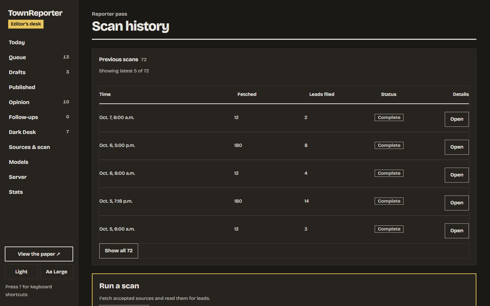

Three ways to start one:

- **Run scan now** on **Today** (in The wire) or on the **Queue**. These use the shared **Model for this scan** picker.
- On **Sources & scan**, in the **Daily scan** panel: **Run scan now** (owner only; runs the daily plan on demand with the saved daily settings) and **Scan every accepted source (N)** (any editor; a general scan).
- On **Scan history**, **Run a scan**: choose a **Scan scope**, a model and press **Run scan**.

**The three scan scopes:**

- **General Scan** — every accepted source.
- **Section scan** — only the accepted sources assigned to one section (pick the section). A section with no accepted sources cannot start.
- **Custom sources** — exactly the set you pick. Search accepted sources by name or address, filter by **Kind** and **Tier**, tick any number, with a live count. Only accepted sources can be picked. The chosen list is saved into the run before the first fetch.

**Saved source packs.** Press **Save selection as pack** to keep a named set. Pick a pack from **Saved pack** to run it, **Update pack with selection**, **Rename…** or **Delete pack** (with **Undo**). A pack uses its current accepted members when it runs.

The picker on the scan panel is for that press only. If a scan is already running with a different model, the desk warns and offers **Stop and restart with <model>**. If the paper is not set up, or you have started more than 10 scans this hour, it warns too and offers **Run anyway**.

**What the reader does.** It asks for one page at a time from any one site, with a pause between requests. It reads only pages on the watch list. A scan reads sources in batches of 16 within a 90-minute budget. Sources never read come first, then the oldest read. Sources that are waiting, blocked or over the limit are skipped and the scan says so. A scan interrupted midway does not resume; start it again.

**What a finished scan says.** A coverage line such as “Read 180 of 201 · 15 wait their turn · 6 blocked” and, under **Source routes and gaps (N)**, each source that was skipped or blocked and why. A summary says how many sources were selected, fetched, failed and analysed, how many leads were filed and how many batches ran. A scan that finds nothing is shown as a success with zero leads (“Fetched N. Filed nothing.”), not an error. A model failure is shown as a failure. A partial scan says “Scan finished with partial coverage”. A scan row that says **Stalled** most likely lost its worker when the app restarted; nothing was lost, so run it again. If the desk cannot scan at all (no model ready, nothing loaded locally) you get “The desk cannot scan yet.” with the reason and, for a lapsed login, a **Sign in to Claude Code** or **Sign in to Codex** button, before anything is fetched. **Open the queue** shows what was filed.

**Previous scans.** The panel shows the newest five scans with date, fetched count, leads filed and a status (**Complete**, **Running**, **Failed**, **Stalled**, or a note such as “Cancelled after 40 of 201 sources; 2 leads filed before it stopped stay on the Queue”). **Show all 39** loads older ones. Each row has an **Open** that shows whether it was a scheduled or a manual scan and its summary.

**Captured meetings** (bottom of Scan history) lists what meeting capture has saved: the meeting, whether the transcript is from official captions or speech-to-text, whether it was matched to agenda items, and a link **Open the story** when a draft or lead was filed. Setting up capture and **Run meetings now** are on the Server page. A transcript is a map of the tape, not the minutes.

**The daily scan.** The owner sets it up on **Server → Daily scan** (see [The Server page](#server-deskops)). When it is on, the desk reads the owner’s fixed picks first, then every other accepted source oldest-read first, inside the 90-minute budget, once a day at the chosen local time. If the app was off at that time, the next check that same day runs it once; missed days are not replayed. It files leads only.

---

## The queue

`/desk/queue` — every lead the paper holds, scored and sorted. The scanner files here, Dark Desk files here, imports land here, and so do you. Nothing prints from this list; you open a lead and publish from its story page.

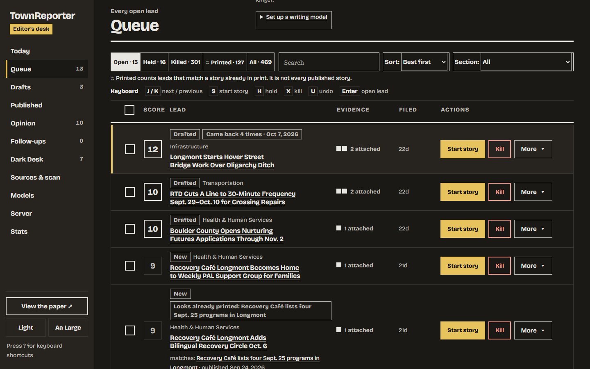

### The top of the page

- **Model for this scan**: a model picker for the next scan only.
- **Run scan now**: starts a scan of the accepted sources. A scan card with its stages and **Cancel** appears under the tabs. The scan files leads a batch at a time, so the list fills while it runs. More than 10 scan starts in an hour asks first (**Run anyway**).
- **Add a lead**: see [Add a lead](#add-a-lead).
- **+ New story**: opens the older Write a story form.

### Find the lead you want

- **Tabs:** **Open** (not held, killed or published), **Held**, **Killed**, **≈ Printed** (leads that match a story already in print; it is not every published story) and **All**. Each shows a count, or the word “loading”. A Held count in the “waiting” style means leads are waiting on you.
- **Search** matches the headline, the why-line and the section key.
- **Sort:** **Best first**, **Newest first**, **Oldest first**. On the Killed tab all three order by when the lead was killed.
- **Section:** **All**, or one of the paper’s sections.
- The list shows 25 rows; **Show 25 more** adds more.
- **J / K / S / H / X / U / Enter** work on the highlighted row.

### What a row shows

| Part | Meaning |
|---|---|
| Tick box | Select the row for the bulk bar |
| Score | Newsworthiness out of 20 (warm at 10, hot at 14) |
| Chips | The section; the status (**New**, **Drafted**, **Held**, **Killed**, **Published**); **Section not chosen — pick one** when the scan guessed the section; **Imported**; **Looks already printed: <headline>**; **Came back N times** |
| Headline | A link to the story page |
| Evidence | One small square per source link and a count such as “3 opened · 1 attached” |
| Filed | How long ago; killed rows add the kill date |

**Row buttons.** A New or Drafted lead has **Start story**, **Kill** and **More ▾**. A Held lead has **Release**, **Kill** and **More ▾**. A Killed lead has **Bring back** and **More ▾**. **Start story** opens the story page and spends no model.

**More ▾ menu:** **Edit the lead**; **Hold with a reason**; **Kill as duplicate** (when the lead matches a printed story); **Send to Dark Desk** (opens a Dark Desk file filled in from this lead); **Start an AI follow-up**; **Kill with a reason**; **Open**; **The piece** (the printed story); **Back**; **Hold (no reason)**; the block **Draft with a chosen model**; and **Delete**.

**To draft a lead from the Queue:** open **More ▾**, find **Draft with a chosen model**, check the model (press “Model: … · change” to pick another), then press **Draft with AI** (**Redraft with AI** if it already has a draft). The row says “Draft queued with <model>. Open the lead to watch it arrive.” Press **Open** or the headline to watch it.

### Kill, hold, release and bring back

- **Kill** is one press. The lead moves to Killed and a small strip at the bottom says **Lead killed.** with **Undo** for 8 seconds. It shows no reason chips and does not move when the mouse is on it. On a phone it leaves a 16 px gap on each side. Kill is not delete: the lead stays under Killed.
- **Kill with a reason** (More ▾) and **Kill this lead** on the story page open the full **Kill this lead** dialog with quick fills (**Not news**, **Already printed**, **Outside our area**, **Bad source or unreadable**), your own words and an optional link. **Kill as duplicate** remains in the More ▾ menu.
- **Hold with a reason** lets you say **Waiting on a record or date**, **Waiting on an AI follow-up** or **Not now, maybe later**, plus a note. A held lead waits under Held until you press **Release**.
- If a lead has a draft or a published story, Kill and Hold warn first with **Kill anyway** or **Hold anyway**. The draft and the story are kept.
- **Bring back** returns a killed lead to the Queue, and a drafted lead comes back as Drafted.
- **Delete** (in More ▾) asks once, in the row: “Deletes this lead and any draft on it.” Press **Yes, delete** or **Keep**. A deleted lead is kept for 30 days under **Server → Recently deleted**, and **Undo** appears where you deleted it. A published story stays on the paper.

### Came back, and possible duplicates

The scanner never throws a lead away. When the word rule finds nothing in a scan batch, the desk makes one extra model call. It compares every new lead with recent desk leads from the last 30 days (at most 300; killed leads are included), printed stories from the last 30 days (at most 150), and earlier leads of the same scan. If the call fails, the scan files leads as before.

- **Same story, no new fact:** the old lead is marked **Came back N times** (with the date), and nothing new is filed. A lead killed as a duplicate stays killed.
- **Same story with a new fact:** the new lead is filed as **Held** and linked to the old lead as **Possible duplicate**.
- **Same as an earlier lead of the same scan:** the new lead is merged into it, and the source links are joined.
- **Matches a printed story:** the new lead is filed as **Held**, not Open.

An AI duplicate never lands in Open. When a linked lead needs your decision, press its **Possible duplicate** chip to open the story page, where **Compare these two leads** shows both side by side. The buttons are **Not a duplicate — move to New**, **Same story — kill this one**, and **Newer facts — reopen the old one**. On the Killed tab a line explains: “the scanner found this story again after you killed it. It was not refiled. Back returns it to New.”

### Select several leads

Tick rows to open the bulk bar: “N selected”, **Model for these stories**, **Start N stories**, **Hold**, **Kill**, **Delete selected (N)** and **Clear**.

- **Start N stories** opens **Draft the selected leads**. A usual batch is one to five leads. Pick a model (Automatic is allowed). **Suggested focus size** (3 to 5) and **Add suggested focus (N)** add a balanced set of the best open leads without replacing the ones you ticked. A bigger batch, or a held, killed or published lead, warns first and offers **Draft this batch anyway**. Each lead keeps its own research scope. After you start, the dialog shows the latest batch: each lead’s status and a link to its story, and **Redraft with <model>** when it finishes. **Dismiss** puts a finished batch away.
- **Kill** on several leads kills at once. It does not ask **Why?** and shows one strip, **Killed N leads.**, with **Undo**.
- **Delete selected** asks first and lists each lead.
- A strip may offer **Hold all anyway** or **Kill all anyway** when some selected leads have drafts or published stories.

### Many drafts at once

You can start as many drafts as you like. Leaving the page does not stop a draft; it runs on the server. Two drafts write at a time, and the rest wait in line oldest first, saying what they are waiting for. A draft that uses the local model waits if another local job is running. Scans and Dark Desk digs have their own lines. A running follow-up check makes new drafts wait. There is one draft per story: pressing Draft again with the same model returns the running one; choosing a different model warns, and **Stop and restart with <model>** replaces it. After 20 draft starts in an hour the desk warns that it may cost more and offers **Run anyway**. Waiting drafts resume after a restart.

### Empty and error states

An empty Queue says “Queue is empty — run the first scan or file a lead” (or, when stories are already on the paper, “Nothing open — N already on the paper. Last scan filed no new leads.”) with a **New story** button and a link to **Import finished stories**. If the Queue cannot load, press **Try again**.

---

## Drafts

`/desk/drafts` — everything not yet printed, one row per story.

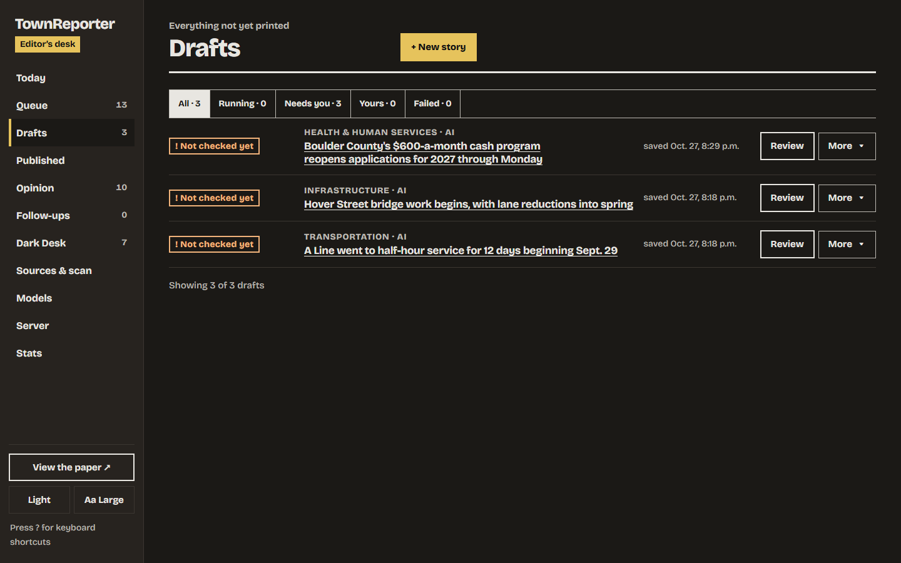

- **Filter pills:** **All**, **Running**, **Needs you**, **Yours** and **Failed**, each with a count that stays blank until it has loaded. **Needs you** means the checks are waiting on you. **Yours** means you wrote or changed the headline.
- **A row** shows a chip (for a finished draft, the readiness chip: **✓ Ready**, **✓ Verified**, **! N to check**, **! Not checked yet**, **✕ Not ready**; for a running one, **Queued · 0:12** or **Writing · 2:18** with a live clock; for a first draft that failed, **Draft failed**), a line such as “Council · AI”, “Council · Written by you” or “Council · Reprint”, the headline, and the model’s name or the time it was saved. A running row carries the full job card with **Cancel**.
- **The button** names the next step: **Watch** (running), **Retry** (failed), **Check** (evidence to check), **Start story** (no draft yet) or **Review** (ready). Every button opens the story page.
- **More ▾:** **Open the story workbench** and **Hold, kill or delete it in the Queue**.
- Only leads that are New, Drafted or Held and have a draft appear here. Killed and published leads do not. The list refreshes itself every few seconds. A row that cannot be shown names the problem and links to the Queue; it does not break the page.

---

## The story workbench

`/desk/story/:id` — where a lead becomes a story. Open it from a Queue row (**Start story**, the headline, or **More ▾ → Open**), from a Drafts row, from Today, or from the link on a running job.

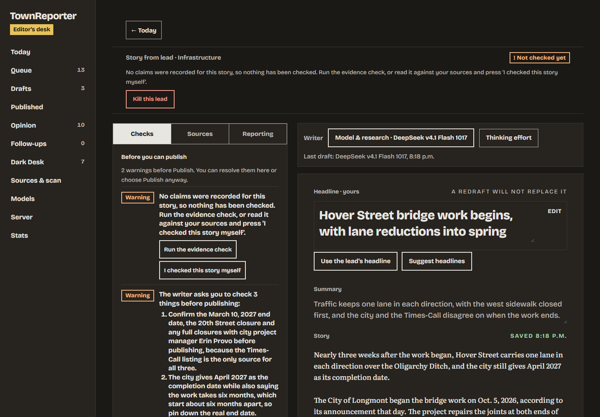

### How the page is laid out

- **Top:** a **← Today** link, “Story from lead · <section>”, a readiness chip, and **Kill this lead** (hidden once a story is on the paper).
- **Left:** three tabs. **Checks** holds the “Before you can publish” list, the evidence check and **Names and spellings**. **Sources** holds **Find evidence**, **Source documents** and **Sources on the lead**. **Reporting** holds **Redraft settings**, the lead, **Reporting notes** and the **Reporting package**. Notes and sources never print.
- **Right:** the writing surface: **Headline · yours**, **Summary** (the line under the headline) and **Story**. A closed **Story details** fold holds **Story direction for AI**, **Topic** (the section), **Geography**, the outlet check and **Pulled notes**.
- **Action row:** **Save edits**, **Check draft against evidence**, **Draft with AI** (or **Redraft…** once there is a draft), **Stop** while a draft runs, and **More ▾**.
- **Bottom:** the Publish bar.

Everything here is open to any signed-in editor. A draft written by the AI is a first pass. Read it against the documents.

### The readiness chip

The chip at the top says where the story stands: **… Checking facts**, **✓ Ready**, **✓ Verified**, **! N to check**, **! Not checked yet**, **✕ Not ready** or **No draft yet**, with a plain sentence beside it. **Not ready** means the desk has a warning on the Publish list. It does not turn Publish off.

### Draft

**To draft a lead with the AI:**

1. Open **Reporting → Redraft settings** (or look at the **Writer** bar) and check the model and the research scope. **Change model or research** opens the choices.
2. Choose a **Drafting scope**:
   - **Research public sources** follows your links and searches for public evidence.
   - **Use only supplied material** reads your text and the documents you attached, and opens only the web addresses you filed yourself. It does not search and does not fetch other pages, and it tells the writer so. Use this control instead of writing “do not search” inside pasted text.
3. Press **Draft with AI**. Press **Redraft…** later to ask for a new version: the box **What should change?** takes your note, the choice **My headline and my edits** keeps your headline, and **Start redraft** begins. Your current saved draft stays in place until the new one finishes.

While it runs, a card named **Drafting story** shows the model, a clock, stage chips (**Opening source material**, **Looking for primary sources**, **Planning the reporting**, **Writing the draft**, **Checking the draft against the evidence**, **Connecting the story to saved sources**), a **Now:** line with the writer’s own step, and **Last activity**. You can leave the page: the draft keeps running on the server. **Stop** (or **Cancel** on the card) ends it and no draft is saved. After 60 seconds with no news the card offers **Keep waiting** and **Retry on next model**.

**Which writer runs.** A normal news lead is written first by the research writer, which can search and read for itself. If it cannot finish, the same model writes the story the usual way and the page says so: “The research writer could not finish (…). The story is being written the usual way, on the same model.” A meeting lead uses the meeting writer. The notes panel is headed **Writer’s notes** on a news lead and **Meeting ledger** on a meeting lead.

**What the model line tells you.** After a draft finishes, the Writer bar shows a receipt: **Last draft: <model>, <time>**. If the desk moved to another model, it says why: “You picked Automatic. <Model> wrote this draft because <reason>.” or “You picked A. B wrote this draft because A timed out.” Reasons include a lapsed sign-in, a usage limit, an empty or unreadable reply, and the model being unavailable. A content refusal never moves to another model; it stops the run.

**Warnings when you press Draft.** The desk may open **Before you continue** with a button such as **Draft anyway**: the model is not ready (“If you draft anyway, the desk will use the next ready writing model”), the lead was killed (drafting puts it back on the desk), a draft is already running on another model (**Stop and restart with <model>**), or you have started 20 drafts this hour (**Run anyway**). For a meeting lead you may be told a model has not been tested with the meeting writer; DeepSeek v4.1 Flash 1017 has.

### Choose the model

The model picker is the same on every screen that uses AI. It is labelled **Writing model** (**Digging model** on Dark Desk) with a **Thinking effort** control under it. See [Models](#models) for the full list and what Automatic does.

### Headline, summary and story

- **Headline · yours** is yours to write at any time. A redraft will not replace a headline you have changed.
- **Use the lead’s headline** puts back the line the scan filed the lead under.
- **Suggest headlines** asks the story model for three options. On a draft it opens a **Headline** box: pick one, **Keep mine**, or type your own, then **Use this headline** (**Suggest 3 more** asks again). Nothing changes until you press **Use this headline**.
- **Summary** is the line under the headline. **Story** is the body; the small line above it says **Saved <time>**, **Unsaved changes** or **Published story**.
- **Save edits** (Ctrl+S) keeps your changes without printing. **Preview as reader** (in **More ▾**) shows the story as a reader would see it.
- **Story details → Story direction for AI** names the decision or question you want covered. It steers the draft and is not evidence. **Topic** is the section the story files under.

### Add to a story

**+ Add to story** (in **More ▾**) opens **Add to this story**: drop new documents or paste text, a link or your own paragraph under **New material**, then choose **How**: **AI weaves it in**, **Add as an update at the top** (marked Updated with the time) or **Paste in as-is at the end**. A first press shows **Now** and **After your change** side by side; nothing is saved until you press **Add** again.

### Documents on the story

The **Sources** tab lists **Source documents** with their reading state and counts such as “3/5 parts read”. Buttons: **Download original** and **Download full extracted text**. The desk reads PDF, Word, Excel, PowerPoint, LibreOffice, text, images (with OCR), CSV and subtitle files; Excel, PowerPoint and LibreOffice files are read with LibreOffice, and if that is missing the row offers **Get LibreOffice** and **Try again**. Up to 20 files, 100 MB each, 20 million characters of text per document. If a document was only partly read, a notice says so and **Read the rest** starts a redraft that reads more.

### Reporting notes

The **Reporting** tab’s **Reporting notes** never print. They hold the news and why it matters, **Still to pull** to-dos (yours are tagged “yours”; type one in **Add a reporting note**), **Claims and sources**, **Verify before print**, and **Documents opened for this draft**. Notes survive a redraft.

**To fetch a missing document:** press **Pull** next to a still-to-pull line. It searches and reads without any AI, and drops the excerpt into **Pulled notes** (in **Story details**) for you to cut into the story. **Stop** and **Continue pull** control it. Redraft reads **Pulled notes**; nothing in them prints.

**Draft history and transcript revisions** lists earlier saved drafts with **View saved draft and evidence**.

### Meeting stories

A meeting lead shows **Where this draft came from**: the meeting recording and the exact transcript passages the saved draft used (**Open transcript**, **Watch the video**, timestamps). **Transcript material considered** is a separate list of candidates and is not proof the draft used them. **Transcript the reporter will read** chooses between the Whisper transcript and YouTube captions; a transcript not aligned to the agenda warns before drafting.

If the transcript changed after the draft, a block reads **Newer transcript available — review before publishing**. Compare each cited passage, tick that you did, write what you verified and press **Save review against current transcript**, or press **Redraft from current transcript**. This is a warning at Publish, not a block.

A speaker name the desk cannot confirm is replaced in the saved copy by “an unidentified speaker”, along with a title next to it such as “Mayor Pro Tem”. Names inside direct quotes or links are kept and still need your check. The mask records what could not be verified; it does not verify anything.

**Report this meeting** (or **Develop this lead** if there is already a draft), in **More ▾**, starts a reporting run: write **What to report on**, add optional **Sources to start from**, choose **Public research** or **Supplied material only** and a model, press **Start reporting**. The **Reporting package** then shows what was read, what was established, what still needs checking, the stories the run filed, an **Action ledger** of meeting actions (set each item’s treatment to **Lead**, **Roundup** or **Excluded**), and **Ask for more reporting** for a follow-up run. **Record a correction or disposition** saves a dated, sourced note for later assignments. The package never publishes.

### Names and spellings

On the **Checks** tab. The desk checks names against written sources it opened. A name marked “needs review” is not established. A source match checks spelling only, not attendance or quotes. Captions and OCR do not confirm their own spellings. Edit the text and redraft or re-check to settle a name.

### Style check

A row in **Checks** appears when the code finds shapes that read badly: an unattributed claim (“Experts say…”), filler, a dressed-up verb, repeated phrases, a very long paragraph and the like. Tick the findings you want fixed and press **Fix these with the model**. The model may not change a quotation, a number, a name or a link; a rewrite that does is refused and your text is kept. The result is saved as an ordinary draft revision. Nothing here blocks or publishes anything.

### Check draft against evidence

**Check draft against evidence** compares the exact saved draft with the web pages the desk captured and the documents you attached. Save your edits first. It does not restart discovery or the first writing pass. A card, **Checking the draft against the evidence**, shows the model and the stage.

When it finishes, the checked version is a new saved draft and your original is kept. If you did not type meanwhile it loads automatically. If you did, your edits are kept and **Reload checked draft** replaces them on purpose. **Compare versions** (in **More ▾**, or **Compare checked vs. previous version**) shows a side-by-side with **Keep checked version** and **Restore previous**; restoring loads the old text as unsaved text until you press **Save edits**. If the captures could not support a full pass, the result is marked incomplete and still needs your review. Neither outcome publishes or approves anything.

### The evidence list

The **Evidence check** list on the Checks tab shows one row per recorded claim. A short line says how many claims the AI checked and how many need you. Chips: **✓ Supported**, **! Needs review**, **Checked · not found**, **Could not check**. The rows that need a person come first; the rows the AI supported are folded under **Show the N claims the AI supported**, with **Spot-check** and **Accept the AI’s supported rows**.

Open a row to see the passage, mechanical checks (does the recorded passage appear in the cited saved copy, is a newer copy available), and **View cited captured version** or **Review newer capture**. Then record your own **Editor judgment**: **Supports**, **Does not support**, **Contradicts** or **Needs reporting**, with a reason. For a sentence the AI called not supported you may **Remove this sentence from the draft** or **Mark checked anyway**. A passage match only shows the words occur in that copy; it does not show the claim is true. Save the draft before saving a judgment.

**+ Add a claim** lets you add a fact you put in yourself and tie it to one to six captured records, marked **Corroborating**, **Contrary** or **Context**. These are private review notes.

If you change the story after its evidence was gathered, the page asks you to choose **I checked: keep this evidence** or **Remove old evidence from public story**. Removing clears the old public source list but keeps the original in the private draft archive.

A draft with no recorded claims and a checkable fact in it (a number, a date, a weekday, a vote) shows **! Not checked yet**. Run the evidence check, or read it against your sources and press **I checked this story myself**.

Only the owner sees **Take down this capture** inside an opened captured record. It deletes the excerpt and stored original, keeps the address and history, and cannot be undone.

### Find evidence

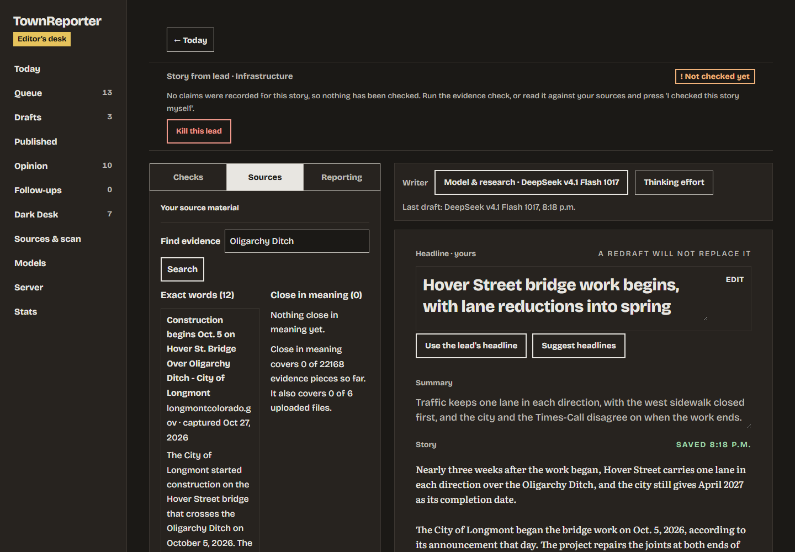

`Sources` tab. A box labelled **Find evidence** takes up to 200 characters (placeholder “Words from the story or its sources”). Press **Search**. Up to three lists appear:

- **Exact words (N)** — pieces of captured pages and transcripts that contain your words.
- **Close in meaning (N)** — captured pieces, and up to three of your uploaded files (marked “your file”), whose meaning is close to what you typed, even when the words differ.
- **Our past stories close in meaning (N)** — the paper’s own published stories on the same subject.

Each captured piece shows its title, host and capture date, an excerpt, **Open** (the original page) and **Add to this story**, which puts that address on the lead’s source list. A past story shows its headline, “Published <date>” and **Open story**; an uploaded file shows **Open that story**. Nothing from a result is ever added to the story’s text. Small lines say how much of the archive is searchable yet, because the desk indexes a little each minute, newest first. If search by meaning is not ready the page says “Search by meaning is not available now. The exact-words list still works.”

This panel is on the editor desk only. The public paper’s search box looks only at headlines and text and has no meaning search. The writer is also given the five closest past stories as background only, with instructions to mention, quote, cite or link nothing from them.

### Publish

The Publish bar sits at the bottom of the page while a draft exists. Its main button names the section the story will print under: **Publish in <Section>**. Pressing it opens a confirmation, not a separate Confirm step to find first. The confirmation says: “This puts the story on the public paper and in the feed, under your name, now. Corrections are published, not silent edits.” Press **Yes, print it in <Section>** or **Not yet**.

If the desk could not place the story, the button reads **No section chosen. Pick one, or publish in <Section> anyway.** Pressing it opens **Story details** and the section chooser. A second button, **Publish anyway in <Section> (no section was chosen)**, publishes at once. A small **change** (or **pick the section**) link beside the button goes to the chooser.

**The app warns; it does not block.** Above the bar a list called **Before you can publish** shows each warning with a **Warning** chip and a button that clears it. The warnings are:

| Warning | What it means | Button |
|---|---|---|
| This draft looks cut off | The body does not end in a full stop or closing quote | **Read the draft** |
| The dek is empty | No line under the headline | **Write a dek** |
| This story is not ready | The readiness reason | **Review remaining checks** |
| This draft was last written … days ago | Older than 14 days; check dates and “Saturday”-style words | **Read the draft** |
| No section has been chosen | | **Pick a section** |
| The body names <Outlet> and the Sources do not show it | Credit another newsroom | **Override <Outlet>** or **Add a source** |
| A claim of absence has not been confirmed | The story says a document is not there | **Confirm the claim** |
| N claims need review | The evidence check raised claims no one judged | **Review the claims**, or **Publish anyway in <Section> — I accept these claims are unreviewed** (records your acceptance, then opens the confirmation) |
| No claims were recorded, so nothing has been checked | | **Run the evidence check** or **I checked this story myself** |
| The story changed after its evidence was checked | | **I checked: keep this evidence** |
| An evidence check is running on this draft | The answer is not in yet | **Publish anyway in <Section>** |
| This draft is on hold / is killed | Publishing un-holds or restores it | **Publish anyway** |
| The recording this draft quotes has changed | A meeting citation is stale | **Review the citation** |
| The writer asks you to check N things | The writer’s own list (**The meeting writer asks you…** on a meeting story) | **Review the checks** |

Only a few true impossibilities turn the button off: an empty headline, an empty story, a publish already running, an evidence decision still saving, and a lead the desk can no longer find. When you publish over warnings the confirmation lists them, the button reads **Publish anyway in <Section>**, and the desk records which warnings you published over and who you are. After you accept unreviewed claims the button reads **Publish now in <Section>**.

**After you publish,** the bar shows a green **Published** button, with **Read it on the paper** and **See it under Published**. The story leaves Drafts and gets its public address under `/articles/…`. To change a printed story, use **Save headline** (the address never changes, the old headline is kept, and no correction is printed) or **Save changes** for the summary, section or body (each warns first: “This story is live. Your change will show on the public page.”, with **Change it anyway**), and **Re-check live evidence**. To post a correction, go to **Published**.

Before you publish: every material number, name, date and quote has a document you can show; a quote or name taken only from a YouTube caption has been checked against the packet or the minutes; and you are willing to put your name on it. The software will not.

### Kill the lead

**Kill this lead** (top of the page) opens **Kill this lead** with the same quick fills as the Queue. Killing keeps any draft, and **Reopen** brings it back. A reported story has no Delete here; Delete is on the Queue row and on editorial pages.

---

## Follow-ups

`/desk/follow-ups` — AI agents that keep watching for an answer to an open question and add what they find to the story’s reporting notes. They never publish.

- **+ New AI follow-up** opens a dialog: **What to find out**, **Where to look** (up to 8 links), an optional **Story**, **Model for this follow-up**, and **How**: **Re-check these pages on a schedule**, **Search the web and public records**, or **Watch for the next agenda or minutes**. Press **Start follow-up**. With no link on a re-check, the desk warns and offers **Create this follow-up anyway**.
- **Filters:** **Active**, **Found something**, **Could not check**, **Stopped**.
- **A card** shows a state chip (**Running now**, **Waiting**, **Found an answer**, **Checked · no change**, **Could not check**, **Stopping…**, **Stopped**, **Finished**), the question, the schedule, the time of the last and next check, and the result in words.
- **Buttons** depend on the state: **Review finding**, **Add to story**, **Mark done**, **Pause**, **Edit**, **Stop**, **Retry now**, **Run now**, **Resume**.
- You can also start one from a Queue row (**More ▾ → Start an AI follow-up**), from a Dark Desk file, or from the **AI follow-ups** rail on Today.

A follow-up is a source of leads to check, not a proven fact. Read the finding and the page it came from before using it.

---

## Meetings and tapes

Longmont’s desk watches three kinds of meeting record. They are not interchangeable.

| Record                              | What it is                                        | Treat as                              |
| ----------------------------------- | ------------------------------------------------- | ------------------------------------- |
| **Packet / agenda PDF** (PrimeGov)  | What staff put in front of the body               | Official, still read it               |
| **Minutes** (PrimeGov, when posted) | The official action                               | Official                              |
| **YouTube tape + captions**         | What was said, including asides and “skip it all” | A map of the meeting, **not minutes** |

How they join: a council video titled like `08/25/2026` joins that day’s packet. A planning video about 206 S. Main joins the Avis notice in that packet. Month must match: June’s museum board is not August’s.

**Captions:**

- Auto-captions invent names. “Kimbark” will come out as something else. Do not publish a proper name off a caption without a check.
- Quotes need a check. Play the tape or read the packet.
- Upcoming livestreams have **no transcript yet**. The desk rechecks; you do not invent one.
- Any extra channel listed under **Server → Paper setup → Meeting video channels** (or **Server → Meeting capture → Meeting channels**) is a sister tape. If the first channel has no captions, the desk can use a matching tape from one of those channels. Same rules.

**Minutes not posted** 36 hours after a council, commission, board or authority meeting (skipping cancelled, continued and TBD items) is a catalog note. It is a reason to look, not a story by itself.

### Meetings with no captions (speech-to-text)

Some tapes have no captions at all, so capture ends at the audio. If the owner has installed **TextFlowKit** on this machine, the desk can listen to that recording and write a transcript from it. The meeting pass you already run (**Run meetings now**, or the scheduled one) queues that work; there is nothing extra to press. One recording is transcribed at a time, and if the machine restarts mid-run the desk picks the work up again. After that, alignment, citations with timestamps, drafts and the publish checks read it the same way as a caption transcript.

Two things to keep straight.

**It is not the city’s record.** The desk labels these rows “Saved transcript: speech-to-text, not official captions.” Everything said about auto-captions applies, and more sharply: a machine listened to audio and wrote down what it thought it heard. Names, numbers and ordinance titles are exactly where it is most confident and most wrong. Play the tape before you print a quote or a name from one.

**The desk says whether it is available.** **Server → Meeting capture** shows one line: “Speech-to-text: textflowkit <version> found at <path>” with its engine, model and language, or “textflowkit not installed … meetings without captions stay audio-only.” If it says not installed, a captionless meeting staying audio-only is the honest outcome, not a fault.

A transcription that fails (tool missing, audio unreadable, run too long) leaves a named reason on the meeting row and keeps the recording where it was. The next pass retries it. Nothing is written over: the audio is never deleted, and a transcript is never stored unless the recording it came from still matches the fingerprint the desk recorded. Speech-to-text never overwrites a caption transcript. If captions turn up later they are a new revision like any other.

### From a meeting recording to a story

After channels and title keywords are saved, the owner opens **Server → Meeting capture**, turns meeting capture on and presses **Run meetings now**. This on-demand pass does not use up the scheduled daily run. **Stop** asks the active pass to stop. **Resume stopped captures** continues eligible partial captures already on disk. **Force re-capture and retain revision** is for one named video when you need to check whether its recording changed.

Open **Sources & scan → Scan history → Captured meetings** to see what the pass found. Each card reports its capture and alignment state. When the desk filed a lead, **Open the story** opens the story page, where the generated draft can be reviewed, edited or redrafted. A captured transcript is not a promise that a story was written: a failed capture, an unaligned agenda, or a lead without a draft is shown as such. Alignment and citations help you find the place in the recording; they do not show every claim is true.

On the story page, **Story details → Story direction for AI** names the decision or question you want covered. An exact ordinance or resolution number is matched to the captured transcript; if that named measure is absent, the draft is refused instead of switching to a different meeting story. **Pulled notes** can give the writer leads to check, but they are not independent evidence and do not print.

**Where this draft came from** shows the transcript passages the saved draft actually used. **Transcript material considered** is a separate list and is not proof the draft used those passages. A timestamp opens the recording at that point. If a newer transcript exists, the page says **Newer transcript available — review before publishing**, names the old and current versions, and compares each cited passage where a match exists. Press **Redraft from current transcript**, or compare each citation, write what you verified and press **Save review against current transcript**. A missing comparison is labelled unavailable and must not be read as confirmation. A stale citation is a warning at Publish, not a block.

A meeting draft is also checked for speaker identity. A name the check cannot resolve is replaced in the saved copy with neutral wording (“an unidentified speaker”), including a title beside it such as “Mayor Pro Tem”. Names inside direct quotes or links are kept and still need your check. The mask records what the desk could not verify; it does not verify anything. If a name matters, read the passage and restore it yourself. Check any vote tally against the tape or the minutes before you print it.

A capture can fail because YouTube rate-limited it (HTTP 429); the desk retries that video on a later pass instead of inventing a transcript.

If a transcript changes after publication, open **Published**. The story shows **Transcript changed — evidence review required** with the old evidence beside the current recording. Check each citation, write a note and press **Still accurate — close review**, or press **Needs correction** and write the correction. The completed review stays with the story and never edits the printed text silently.

---

## Dark Desk (`/desk/dark`)

`/desk/dark` — investigations that never print on their own. Its header reads “Investigations · nothing here prints on its own”.

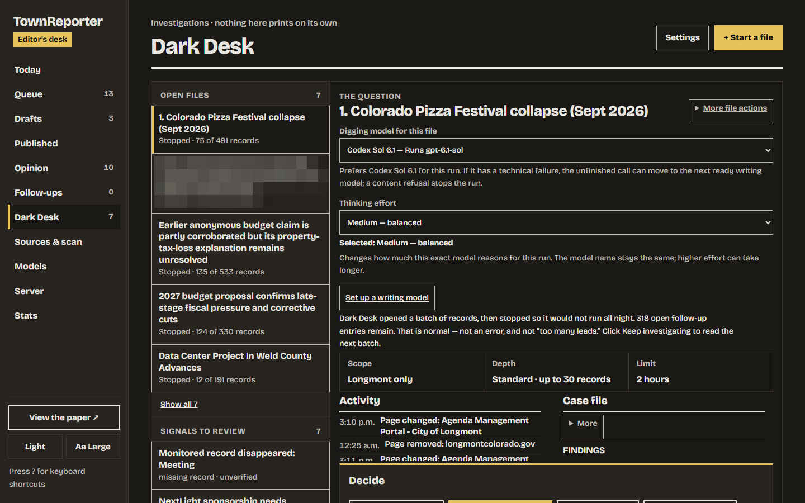

A Dark Desk **file** starts with a question and a tip: a link, a document, a rumour, a name, a contract number. The desk searches, fetches, keeps copies of what it reads, follows names and writes down what it thinks connects, always labelled and always with what would disprove it. For each odd thing it keeps two explanations alive: a concrete theory of what may be happening underneath, and the strongest ordinary explanation. Missing names, recipients, filings and permits become follow-up work, not reasons to drop the lead. “Not found in the material opened so far” never becomes “does not exist”. Any editor can use every control here. Dark Desk has no Publish button by design; the only way out is **Send to the queue**, which files a lead for a person to review.

Dark Desk searches the city and state saved in Paper setup, plus the county saved there if there is one. It does not carry Longmont’s jurisdictions over to another town.

### The left rail

Piles show five files at a time (**Show all N**):

- **Open files** — files you are working. Each row shows a status line such as “Reading · 3 of 12 records”, “Stopped · 12 records”, “Case file ready · 12 records”, “Found an answer”, or “Sent to the queue”.
- **Signals to review** — things the desk noticed: a missing report, a record that changed, an overdue item, an unverified tip. Pressing a card opens **Start a Dark Desk file** with the card’s text filled in; it does not start digging by itself.
- **Waiting on an AI follow-up** — files that have a follow-up or a page watch attached.
- **Set aside** — files you set aside or closed. Nothing is deleted.

The **Dark Desk** number in the navigation counts open files and files waiting on a follow-up.

At the foot of the rail, **Check r/<name> for signals** reads the paper’s Reddit source (see below).

### Start a file

**To start a file:** press **+ Start a file**.

1. **The question** — what you are trying to find out (at least 8 characters).
2. **The tip or starting point** — a link, document, post or what you heard (at least 8 characters).
3. **The ordinary explanation** (optional) — what would make this a non-story. The file tries to rule it out first.
4. **Limits** — **Quick look** (up to 10 records, 20 minutes), **Standard** (30 records, 2 hours) or **Deep** (100 records, 8 hours). It opens on the saved default.
5. **Digging model** and **Thinking effort**.
6. Press **Open the file**. The first round starts at once. You can stop it any time.

### The open file

Top to bottom:

1. **The question** as a heading, and **More file actions**: **Set aside**, **Pull back** (on a closed file), **Start another AI follow-up**.
2. The **ordinary explanation to rule out**, if you gave one, and the **Digging model for this file**. Changing it affects the next round; the file remembers the last model used.
3. While a round runs, a card with four stages (**Question**, **Gather**, **Case file**, **Challenge**), a **Now:** line, and a red **Stop**. If the round fails you get **Retry** and **Retry on next model**.
4. Notes about the file: a round stopped by an app restart (nothing lost), a mostly-blocked warning (“This dig is mostly hitting walls…”), a batch stop (“Dark Desk opened a batch of records, then stopped so it would not run all night … That is normal — not an error”), or the reason a file is paused.
5. Boxes **Scope**, **Depth** and **Limit**, read-only: the area searched, and the limit chosen at the start.
6. **Activity** (time-stamped plain lines; **Show earlier**) beside the **Case file**: **Findings**, **Contradictions**, **Unanswered** and **AI follow-ups running**. A **More** link shows the brief — **Read this first**, **The hypothesis**, **What points at it**, **The boring explanation that also fits**, **What would settle it**, **Do this next** and a percent supported — with **Rewrite the brief**. **Challenge the case** has the desk argue against its own file; it needs at least one sourced finding.
7. **Decide**:
   - **Keep investigating** — start the next round. Dark Desk works in short batches and then stops. A stop with pages still unread is not a failure and not “too many leads”; press this to read the next batch. Lower-priority trails stay visible as deferred work and are picked up again when the active set is done.
   - **Start an AI follow-up** — an agent keeps looking for an answer and reports on Follow-ups.
   - **Wait and watch** — pick captured public pages to watch; the file moves to Waiting.
   - **Send to the queue** — shows a packet for review (**Suggested headline**, **Evidence**, **Uncertainties**, **Contradictions**, **What would kill the story**); press **Send to the queue** to file a lead. An **Undo** is offered for ten seconds. Publication remains an editorial decision.
   - **Close: no finding** — records a no-finding decision with an optional reason. The file stays readable under Set aside.
8. **The file’s records ▸** (closed at first). **What to read** is every captured page and document: click a title and the captured copy opens below, with **Open original**, **Previous** and **Next**. For a retained PDF, **Read selected pages** and **Read entire PDF** read it in batches of up to 12 pages, save each batch, and list exactly which pages remain unread. **Still to pursue** lists open trails (**Follow this lead** opens a new file from one). Further down: every search the round ran (with whether it hit an official record, local press or community source), dead ends, questions the AI tested, and **What we know**.

Do not send yourself to the public `/evidence/…` pages for unpublished captures; those show only records cited in a printed story. Plain English is the rule on this screen: if you see “hop” or a raw error, that is a bug, not a task for you.

### Models and warnings on Dark Desk

The **Digging model** picker is the shared picker (see [Models](#models)). Automatic here tries DeepSeek v4.1 Flash 1017, then a loaded Local model, then Codex Sol 6.1 (balanced), then Claude Sonnet 5.5; if synthesis times out, only that stage moves on, and completed searches are not repeated. A model you name is tried first; a content refusal stops the run. If no model is ready, the round does not start and nothing is spent.

Warnings arrive as **Before you continue** with an “anyway” button: the paper is not set up (**Open this investigation anyway**), a round is running on another model (**Stop and restart with <model>**), or more than 8 rounds an hour (**Run anyway**). The Reddit check is capped at 6 an hour with no override.

### Dark Desk settings (how hard to dig)

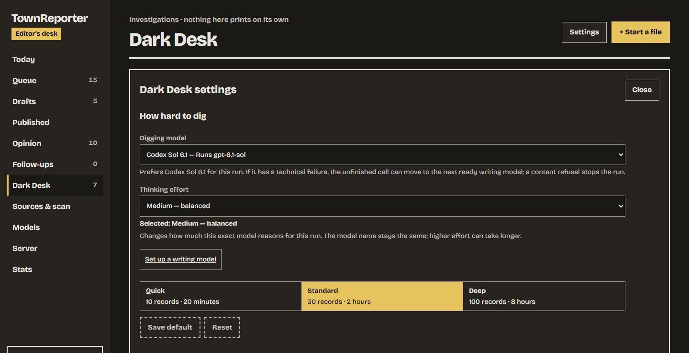

**Settings** (top right) opens **Dark Desk settings**. **How hard to dig** now has three parts: the **Digging model**, **Thinking effort**, and a default depth of **Quick** (10 records · 20 minutes), **Standard** (30 records · 2 hours) or **Deep** (100 records · 8 hours), saved with **Save default** (or **Reset**). Each new file opens on that depth. The older Dig, Nerve and Map sliders, presets and search-window controls are no longer on the screen.

Three rules hold at every setting: the desk never invents a claim that someone was paid; everything it writes is labelled with how mature the evidence is (fact, observation, allegation, inference, hypothesis, unknown); and every theory carries what would kill it. Black Desk signals are speculative and capped at 50 percent confidence in code. A signal marked “protocol complete” means the searches and review questions were done. It is not a verdict. See [the doctrine and its limits](dark-desk.md).

**Watched pages** (also in Settings) lists pages the desk checks daily, with **+ Watch a page**: enter the **Page URL**, a **Watch name**, **Why watch this page?** and optionally an **Investigation**, then **Save watch and capture page**. A first capture, “no text change”, “text changed”, “page moved” and “check failed” are kept as separate outcomes; a failed check never replaces the last readable copy. **Stop watching** keeps the history. Daily checks need the local scheduler running.

**Reddit check.** The button **Check r/<name> for signals** reads the paper’s one Reddit source from Sources through four feeds, then up to three full threads through a local Redlib. It needs exactly one clear subreddit among the accepted sources; otherwise the button says **Reddit unavailable** and links to **Review Sources**. No subreddit is guessed from a town name. Posts are unverified tips. A post that scores high enough and is dated within 30 days is filed as a tip automatically; you can file any listed post by hand with **File as tip**. Each result says whether the full thread or only the RSS excerpt was read.

If you have no files yet, the screen offers **+ Start a file** and the Reddit check. If it cannot load, press **Try again**.

### Watch a specific page in Dark Desk

Use this for a page that might change or vanish: a city notice, a board roster, a company page.

1. On Dark Desk, press **Settings** (top right).
2. Under **Watched pages**, press **+ Watch a page**.
3. Enter the **Page URL**, a **Watch name** and **Why watch this page?**. Optionally pick an **Investigation** to attach it to.
4. Press **Save watch and capture page**.

The desk saves a first copy now and checks again daily while the local scheduler runs. Each check is kept as its own result: **no text change**, **text changed**, **page moved** or **check failed**. A failed check never replaces the last readable copy. **Stop watching** ends the checks and keeps the history.

---

## Opinion

`/desk/opinion` — the paper’s own position.

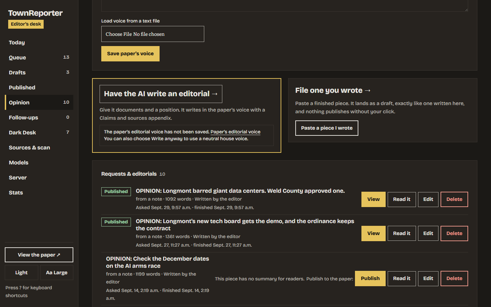

An editorial is an unsigned draft of the paper’s position until you publish it. “OPINION” goes at the front of the headline and there is no byline. Claims and sources run in an appendix at the end for readers who disagree. An editor’s fact sheet and an image prompt are kept for you and never print.

### Write an editorial with the AI

**To write one:**

1. Press **+ New editorial**, or the card **Have the AI write an editorial →**.
2. Give it a position in **Subject, source text, or links**, and/or add documents (**Add documents**, up to 20; PDF, Word, Excel, PowerPoint, text, images with OCR). Keep the writing instruction separate from the evidence. **Anything you want it to know (optional)** is for the angle.
3. Choose **Drafting scope**: **Research public sources** or **Use only supplied material**.
4. Choose the **Writing model**. Opinion opens on **Automatic**. Opinion’s own Automatic tries **DeepSeek v4.1 Flash 1017**, then **Codex Sol 6.1**, then **Claude Sonnet 5.5**. It has no Local model rung. A named choice is tried first; a technical failure can move only the unfinished call; a refusal is final.
5. Press **Write an editorial**.

The desk writes with the paper’s **editorial voice**, a text file that also holds the research protocol. If none is saved, the page says “The paper’s editorial voice has not been saved.” The owner sets it in the **Paper’s editorial voice** panel on this page (paste it or **Load voice from a text file**, at least 500 characters, then **Save paper’s voice**). An editor can press **Write anyway** to use a neutral house voice.

Claude and Codex research and write in one run with the voice in hand. DeepSeek, Local model and saved connections have no web tools, so the desk does their searching and reading first, local record first: the city’s PrimeGov agendas, packets and minutes, the meeting transcripts the desk captured, and pages it already holds. It stops when its protocol is satisfied or at a safety ceiling of 30 minutes and 80 pages. An editorial is the most expensive thing the newsroom does and can take 10 to 40 minutes. The row shows a running clock and the page re-checks every 20 seconds. **Cancel** stops it before anything is written.

The desk checks that the result is really an editorial. A provider refusal, a limitation note, an implausible headline or an incomplete body makes the row **Failed** and files no draft; there is then no Read, Edit or Publish button to mistake for success. A failed row offers **Restore saved material**, which puts your subject and instruction back in the form (press **Have the AI write an editorial →** to see them).

Three things warn first and offer a **Write anyway** button: the paper is not fully set up, more than 20 documents, or material over 20 million characters.

### File one you wrote

**Paste a piece I wrote** takes the piece with the headline on the first line. **CLAIMS AND SOURCES**, **EDITOR’S FACT SHEET** and an image prompt are picked up if they are there. Press **File it as a draft**. It lands as the editor’s own words, exactly like one written here. Machine citation markers are removed and you are told to re-add real source links.

### The list

**Requests & editorials** lists every request and piece. A chip says **Writing m:ss**, **Stalled**, **Failed**, **Published**, or **! Claims missing**. Buttons: **Read it** / **Close**, **Edit** (opens the draft workbench at `/desk/story/draft/:id`), **Publish** or **Publish anyway**, **View**, **Repair claims**, and **Delete**. Delete asks in the row (**Yes, delete** / **Keep**), keeps a copy for 30 days and offers **Undo**. A stalled row says the app likely restarted and nothing was lost.

**Read it** opens the piece with its claims, name check, fact sheet and image prompt (each with a copy button). **Publish to the paper** publishes from there.

### Publish an editorial

Publish warns, never blocks. One box lists every warning with one button, **Publish anyway**:

- No dek yet.
- The evidence needs review before publishing an edited editorial.
- **Claims and sources are incomplete.** Every op-ed needs a sourced appendix with a link or a document filename and a page or section locator. The button then reads **Publish anyway — I accept these claims are unreviewed**.
- Choose the section the editorial files under.

The only refusals are a missing headline or body. On the draft workbench the button is **Publish in <Section>** and opens a confirmation: “This puts the piece on the public paper and in the feed, as the paper’s own position. Corrections are published, not silent edits.” The public paper shows no AI line on the editorial or on any story.

---

## Models

`/desk/models` — which AI does which job, and whether it is actually connected. Any editor can read this screen; only the owner can change it.

Behind every AI button on the desk is the same **model picker**. It is labelled **Writing model** (**Digging model** on Dark Desk), with a **Thinking effort** control under it. The list is the same everywhere:

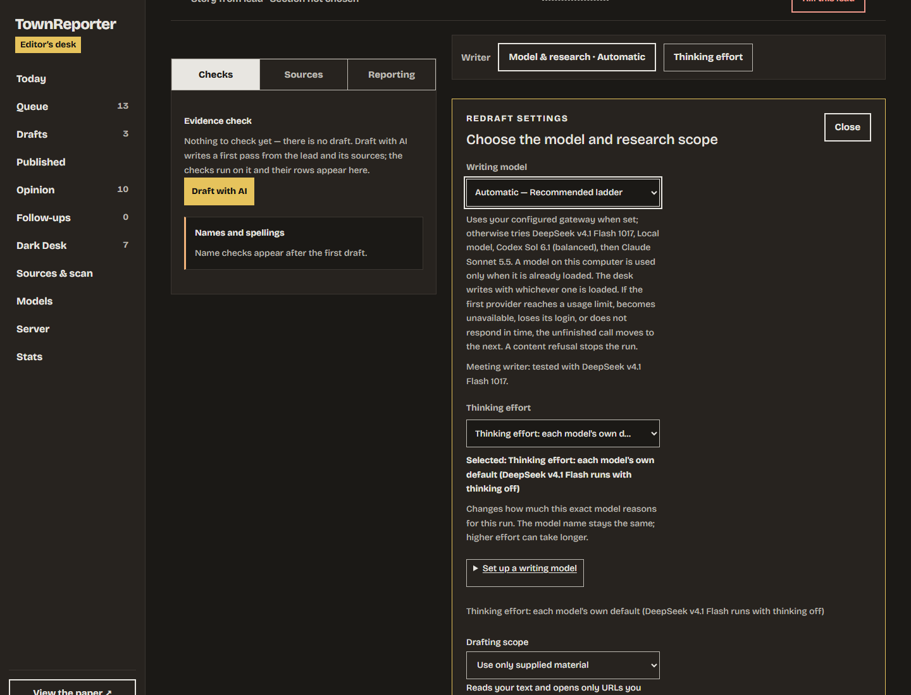

| Choice | What it is |
|---|---|
| **Automatic — Recommended ladder** | The desk tries models in a fixed order (below) |
| **Codex Astra 6**, **Codex Sol 6.1**, **Codex Luna 6** | OpenAI models, through the Codex program signed in on this machine |
| **Gemini 3.8 Flash (Pro plan)**, **Gemini 3.1 Pro (Pro plan)** | Google models, through the Gemini program signed in to your Google Pro plan. A named pick only; never part of Automatic |
| **Claude Fable 5.1**, **Claude Opus 5.5**, **Claude Sonnet 5.5**, **Claude Haiku 5.5** | Anthropic models, through the Claude Code program signed in on this machine |
| **Local model** | A model already loaded in LM Studio, Ollama or llama.cpp on this computer |
| **DeepSeek v4.1 Flash 1017** | The paper’s default writer, run through Ollama and the Claude Code program, with thinking off |
| **<name> (key)** | A saved API connection you added yourself |

A model that is not ready shows the reason after its name.

**What Automatic does.** It tries, in order: **DeepSeek v4.1 Flash 1017**, then **Local model** (only if one is already loaded; TownReporter never loads one for you), then **Codex Sol 6.1 (balanced)**, then **Claude Sonnet 5.5**. If the first reaches a usage limit, becomes unavailable, loses its login or runs out of time, the unfinished call moves to the next one that is ready, once, and the desk shows the move. A content refusal stops the run. Gemini is never on the ladder. Opus is never picked by Automatic.

**Opinion has its own shorter Automatic:** DeepSeek v4.1 Flash 1017, then Codex Sol 6.1, then Claude Sonnet 5.5. See [Opinion](#opinion).

**A model you name** is tried first. A technical failure can move only the unfinished call to the next ready model; a content refusal is final.

**Thinking effort** is the choice of how hard the model thinks: **None — fastest**, **Low — faster**, **Medium — balanced**, **High — deeper**, **Extra high — longest** or **Maximum — hardest work**. Each model offers only the levels it supports. DeepSeek v4.1 Flash 1017 always starts at None.

**To choose the Local model:** the owner opens **Models → Connections → Local & self-hosted**, finds **The desk’s local model**, and chooses **Use whatever model is loaded (recommended)** or **Always use one model**. Editors see the choice read-only.

**Set up a writing model,** under every picker, explains how to install and sign in to the Codex, Claude Code and Gemini programs and how to add your own API. TownReporter does not install software or sign you in from that box.

### Who does what

The first tab lists nine jobs. For each, the owner picks a **First choice**, an **Effort**, and up to two fallbacks:

1. **Daily scan & lead filing**
2. **Lead scoring & duplicates**
3. **Story drafting**
4. **Opinion writing**
5. **Evidence check**
6. **Headline suggestions**
7. **Dark Desk research**
8. **AI follow-ups**
9. **Document reading & OCR**

Press **Save assignments** (or **Reset**). Whatever is saved here is what runs: every picker on the desk starts on the job’s saved first choice, and an editor’s pick for one run beats it. A fallback is used only after a technical failure. A small chip under a job says whether its model is **Ready**, **Sign in needed**, **Turned off**, **Not installed**, **Last test failed** or has a **Warning**. A job left on Automatic shows no chip. Above the table, **Models on this computer** lists what LM Studio or Ollama reports, with **Refresh**. Speech-to-text for recordings uses TextFlowKit (Whisper); the chat picker does not apply to it.

### Connections

The second tab, **Connections**, has three groups.

- **Frontier · API key.** Your saved API connections. Each card has **Test**, **Settings** and **Remove**. **+ Add a connection** (owner) opens **Add a connection**: a name, a **Base URL**, an optional **API key** (stored encrypted on the server, never shown again) and a model id. A **Set up Gemini** button fills in the Gemini preset. Each saved connection can be edited, have models discovered, tested (**Test connection**; this may cost a small charge), disabled and deleted (permanent).
- **Subscription sign-ins (OAuth).** Cards for **Claude Code** and **Codex** show whether the program is installed and signed in, with **Sign in to Claude Code** / **Sign in to Codex** and **Test**. A sign-in shows a link to open and, for Codex, a one-time code; the card turns to **Signed in** by itself. **Test** asks the model for one word and says how long it took: the only button that proves it can write. There is no Sign out, on purpose. Being signed in to claude.ai in a browser is a different login and does not count. A **Gemini (Pro plan)** card shows **Ready** or **Not ready** only; install the Gemini program and sign in with Google on that machine.
- **Local & self-hosted.** One card per local server (LM Studio, Ollama, llama.cpp), showing its models, which is in memory and which the desk uses, and **Use this one** for the owner. **Test all connections** (top of the page) re-reads every sign-in and looks for servers; it asks no model a question.

When a draft fails because a login lapsed, the error carries a **Sign in to Claude Code** or **Sign in to Codex** button that takes you to the sign-in with the link ready.

### Signing in to a writing model

The desk writes through programs installed on this machine, using the subscription you already pay for: **Claude Code** and **Codex** (and **Gemini** on a Google Pro plan). When a login runs out, drafts fail with a “sign in” message. The fix is on **Models → Connections → Subscription sign-ins (OAuth)**, and the same cards are reached from **Server → Writing models** (`/desk/ops/writing-models`).

Each card says in words whether the program is installed, whether it is signed in, and whether it has been turned off.

1. Press **Sign in to Claude Code** or **Sign in to Codex**. The card shows what the program prints. For Claude Code that is a link: open it and finish signing in. For Codex it is a link **and** a one-time code: open the link and type the code.
2. Wait a few seconds. The card turns to **Signed in** by itself. A countdown shows, with a **Cancel** if you change your mind.
3. Press **Test**. It asks the model for one word and says how long it took. It is the only button that proves the desk can actually write: a login can look present and still be refused by the provider.

There is no Sign out, on purpose. A stale login is fixed by signing in again, not by signing out first. **Being signed in to claude.ai in your browser or in the Claude desktop app is a different login and does not count.** The desk sees only the command-line program’s login.

When a draft or scan fails because a login lapsed, the error carries a **Sign in to Claude Code** or **Sign in to Codex** button. Pressing it starts the sign-in and takes you to the card with the link waiting.

### How long a model may take

**Server → Time budgets** (owner only) has a **Time per call** field for each program: how long the desk waits for one answer before giving up. By default that is 5 minutes for the Codex, Claude Code and Gemini programs and 10 minutes for local models. **Save** stores a value; **Reset** puts the shipped value back. You can set anything from 10 seconds to 60 minutes. Outside that range the field tells you the range instead of picking a number for you.

Most people never touch it. A model can take several minutes to read a long document pack, and a short limit would report that as a failure every time. Raising the number does not make a model faster or slower; it only changes how long the desk waits.

### Add your own AI API

Owner only. On **Models → Connections**, under **Frontier · API key**, press **+ Add a connection**. Fill in a name, a **Base URL**, an optional **API key** and a model id, and save. The key is stored encrypted on the server and never shown again. **Set up Gemini** fills in the Gemini preset. The card then has **Test connection** (this may cost a small charge), **Settings** (edit, discover models, disable) and **Remove**. The model appears in every picker as “<name> (key)” and is tried when you pick it by name.

---

## Server (`/desk/ops`)

`/desk/ops` — this machine’s health and the owner’s settings.

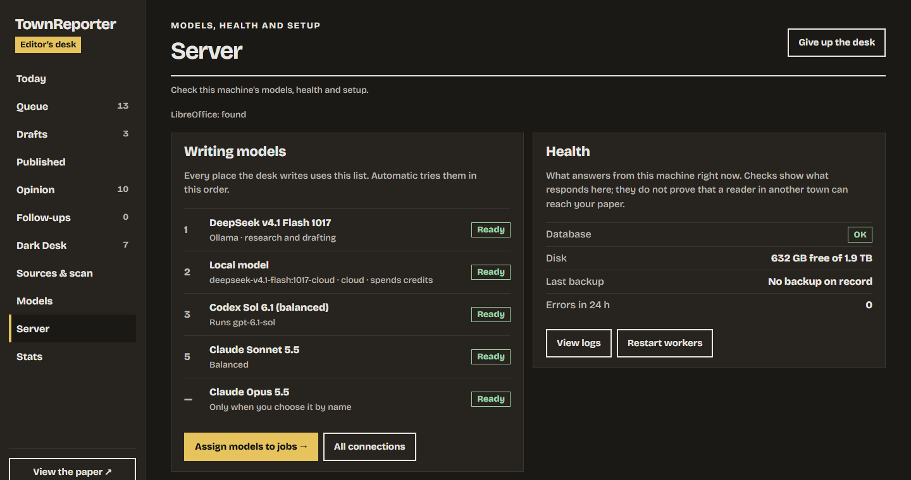

The page is a grid of twelve cards. Each shows a few numbers and has a button that opens that card’s own screen (with a **← Server** link back). Most cards are for the owner only; an editor sees the title and one sentence saying so. A line at the top says whether LibreOffice is found (Excel and PowerPoint files are skipped without it). At the bottom, **Dark Desk run history** lists recent runs with their model and usage.

| Card | What it is | Who |
|---|---|---|
| **Writing models** | The Automatic ladder, numbered. **Assign models to jobs →** and **All connections** | Everyone sees the ladder |
| **Health** | Database, disk, last backup, errors in 24 hours. **View logs**, **Restart workers** | Owner |
| **Paper setup** | The paper’s name, town and watch list; **Edit setup**, **Invite an editor** | Owner |
| **Recently deleted** | The 30-day trash. **Open trash** | Any editor |
| **Sections** | The paper’s sections. **Edit sections** | Owner |
| **Daily scan** | The scheduled scan. **Scan settings** | Owner |
| **Meeting capture** | Public meeting recordings and transcripts. **Capture settings** | Owner |
| **YouTube** | The YouTube key. **Replace key** | Any editor |
| **Routine notices** | What the desk may print on its own. **Notice rules** | Owner |
| **Named outlets** | Outlets a story must credit. **Edit outlets** | Owner |
| **Editors & access** | Invites, recovery codes, Give up the desk | Owner; everyone for Give up the desk |
| **Time budgets** | How long one answer from each model may take. **Adjust times** | Owner |

### Health

The screen lists the checks (Paper, Running for, Public site, Database, Work queue, Disk, Last backup, errors in 24 hours) and refreshes every 30 seconds. **Check now** re-reads them. The Last backup row shows the age of the last good backup, and the note counts the backups kept on the backup drive (three days). **View logs** shows the last lines of each log. **Restart workers** reveals six actions, each with a **Run** button and a line saying what it does first: **Run health check now**, **Restart the tunnel**, **Restart the paper**, **Apply database migrations**, **Re-download the fonts** and **Rotate the logs**. The two that interrupt the paper ask again with **Yes, do it**. On the Windows package, the health check is read-only and no tunnel or watchdog exists, so those actions show “Unavailable”; use **Start TownReporter** and **Stop TownReporter** if the desk cannot be reached. Local readiness does not prove a reader in another town can reach the paper.

### Paper setup

The same fields as first-run setup, with **Save**. It also holds the **County** (Dark Desk searches the city and the county; blank searches the city only) and **The paper’s newsletter mailbox**: a mailbox the paper owns (address, IMAP host, port, SSL, password) that is subscribed to newsletters from your sources. The desk checks it about every 30 minutes, reads only senders you allowed on a source, and lists newsletters that still need a confirmation click under **Waiting for you**. **Test connection** checks the saved mailbox.

### Recently deleted

Everything deleted from the desk waits here for 30 days. **Restore** puts it back where it was, with its original address and corrections. **Delete for good** asks again (**Yes, for good**) and then nothing is left to restore. It does not erase old database backups; legal removal is a separate owner process.

### Newspaper sections

`Server → Sections` — **Newspaper sections**. Add a name and permanent key, rename the display label, move sections up or down, hide them from the section navigation, write a reporting brief and scan instructions, and choose the accepted sources each section reads. Keys cannot change after saving. Hiding does not delete stories. A section with no sources says so and opens its list; **Add a new source to this section** takes a URL and optional label and puts the page on the watch list at once (the section’s use of it is saved at **Confirm and apply**). Retire a section only into another active reporting section (**Retire into**): its leads, drafts and articles move, and old links follow. Opinion and About are reserved pages and cannot retire.

Nothing is saved until you press **Review changes**, check the summary (names, order, visibility, replacement, brief, instructions and sources), and press **Confirm and apply** (**Confirm retirement and apply** when retiring). **Back to editing** keeps your draft, **Cancel changes** discards it, and **Reload saved configuration** replaces it with what is saved. While you have unsaved changes a bar at the bottom says **You have unsaved section changes**, and leaving the page asks first (**Stay on this page**).

### Daily scan

Owner only. Turn on **Run once each day**, set the **Local time**, choose the **Writing model** (Automatic by default) and effort, set **Daily priority set** and **Read every day**, and tick the accepted sources you want read first. Every other accepted source is still read by age, never-read first, inside a 90-minute budget. Values outside the usual range warn and offer **Save this schedule anyway**. **Save daily scan**, **Pause daily scan** and **Resume daily scan** control it; the status block shows the next run, the last run, and the model asked for and the model that ran. A usage limit does not pause the schedule; the next day runs and the model call can move on. It pauses itself, with the reason shown, if the timezone is invalid, the owner account changed or the chosen model cannot start. It files leads only. **Open scan history** and **Open the queue** are below.

### Meeting capture

Owner only. It shows whether TextFlowKit speech-to-text is installed (“meetings without captions stay audio-only” if not). Settings: turn **Meeting capture** on, list the **Meeting channels** (YouTube channel URLs in priority order), choose the **Storage root**, the **Retention mode** (**Transcript only**, **Audio only**, **Media**) and the capture caps (duration and size; a longer or larger capture is refused with a reason, never cut short). **Run meetings now** starts a pass without using the scheduled run, **Stop** asks it to stop, **Resume stopped captures** continues partial captures, and **Force re-capture and retain revision** re-checks one video. See **Scan history → Captured meetings** for results. Speech-to-text is not the city’s record: names, numbers and ordinance titles are where it is most confident and most wrong.

### YouTube

Paste a YouTube Data API v3 key and press **Save key**, then **Test** (spends one of the day’s 10,000 free units). With a key the desk reads channel videos from Google’s official service; without one, or when Google refuses for quota, it reads the public feed and says so. The key is encrypted and never shown again; **Remove** takes it out. Transcripts and media still come from yt-dlp and TextFlowKit.

### Routine notices

Owner only; three parts.

- **Routine notice permissions** — choose exact accepted source and format pairs: **Library notices**, **Parks and recreation notices**, **Community and arts event logistics**, **Routine registration deadlines**, **Waste and recycling schedules**, **Public meeting logistics** (up to 60 pairs). **Pause routine notice permissions** stops later checks. Permissions alone never publish.
- **Manual notice checks** — **Check captured notices** reads an approved source once and reports what it found structurally. “Parsed” means the fields fit the format; it does not verify the issuer, facts or authority. Checks create no lead, draft or article.
- **Automatic routine editions** — owner only; **starts paused**. Choose up to 12 approved sources and for each the **Authoritative issuer**, **Locality**, **Public attribution URL** and, where needed, the **Area or branch** (never a household address). Choose the **Today section**, **Weekend section** and **Deadlines section** and the local time. **Save paused settings**, or **Save and activate**. After activation the daily scheduler files **Today in town**, a Friday **This weekend** and **Deadlines approaching** (only new or changed deadlines in the next seven days). Anything cancelled, conflicting, risky or unclear stays out and is counted for review. A real source change corrects an edition the automation owns; a story an editor edited, removed or unpublished is left alone. **Recent runs** show counts of eligible, published, corrected and needs-review items, with **Why they need review** and **Review source checks**. Disable it, or pause permissions, to stop later editions.

### Named outlets

Owner only. A published story that names one of these outlets has to show the reader its source; if it does not, the Publish list warns and an editor can add the source or override that outlet for that draft. The panel says which of three states you are in: **Using the built-in list (N outlets)**, **This paper checks N outlets**, or **This paper checks no outlet names** (a decision, with a warning that Publish will no longer flag work from other newsrooms). **Customize** copies the built-in list into a draft. Edit **Outlet name**, **Aliases** and **Domain** per row (**Add outlet**, **Remove outlet**). **Review changes** shows what is added, removed and changed and which published stories stop being checked, then **Confirm and apply** writes it.

### Editors & access

Open to everyone, because it holds your way out.

- **Invite an editor** (owner): enter **Their email**, press **Make the invite link**, copy the link or the ready-made message and send it yourself; TownReporter sends no email. The link works once, for that address only, and expires after seven days. **Pending invites** lists open links with **Cancel invite**. Editors can report, draft and publish; ownership, invitations, legal removals and owner-only settings stay with the owner.
- **Recovery codes** (owner): **Generate recovery codes** makes ten single-use codes, shown once. Tick **I saved these somewhere safe.**, then **Download as .txt** or **Done**. Generating a new set retires the old one.
- **Give up the desk** (anyone): see [Sign in and first run](#sign-in-and-first-run).

### Time budgets

Owner only. **Time per call** is how long the desk waits for one answer from a model before giving up: by default 5 minutes for the Codex, Claude Code and Gemini programs and 10 minutes for local models. Set any value from 10 seconds to 60 minutes and press **Save**; **Reset** returns the shipped value. Raising it does not make a model faster. It only changes how long the desk will wait.

### Legal removals

`/desk/legal-removals` — owner only; reached from **Published** and from search. A separate process for removing a story and its connected application copies, with no Undo. See [Legal removal: owner workflow](#legal-removal-owner-workflow).

---

## Stats

`/desk/stats` — any signed-in editor, read-only. Counts of anonymous page loads: no cookies, no accounts, no stored addresses, no identifier that lasts past the day.

- **Range buttons:** **Today**, **7 days**, **30 days**, **12 months**. **Export CSV** downloads the numbers.
- **Reading right now:** readers on the site this minute and the pages they are on, refreshed every 15 seconds. **Arriving from, right now** and **Right now, readers are on** (phone, tablet, computer).
- **Six tiles**, each compared with the period before: **Visits**, **Page loads**, **Avg reading time**, **Total reading**, **Read another story**, **Left without reading**.
- **Stories, by how much they were read:** each published story’s visits, average read, how far readers got, and whether they opened another.
- **Where visits come from**, **Where readers are** (a place is named only on days when at least 25 readers were counted there; everything smaller is **Other places**), **Visitors** (an estimate that can be wrong both ways), **Sections, by reading time**, **When people read** and **Trust signals** (clicks on the paper’s own controls, such as View captured version).
- **Section chosen by hand:** how many stories were printed under a section the scanner did not pick.
- **Saved reports:** **Save latest reports** keeps snapshots of the last completed day, week and month on this installation; **Read report** opens one.

These are page loads, not unique people or completed reads. A view is counted by a small signal sent after the page has loaded, so a counting failure can never slow or break the public page.

---

## Published and corrections

`/desk/published` — what is live, and its corrections.

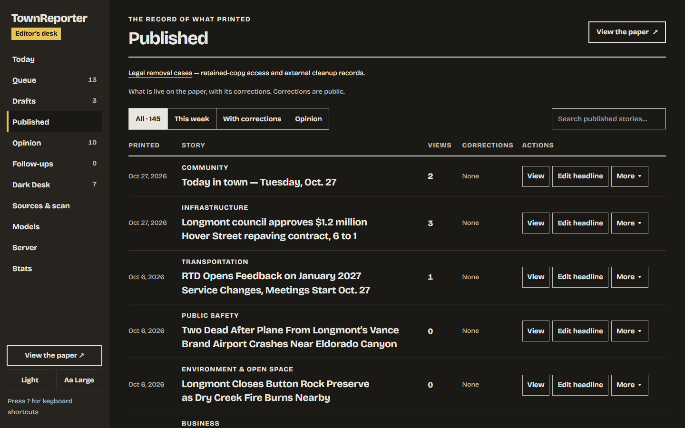

Filter with **All**, **This week**, **With corrections** and **Opinion**, or search headlines and sections. Each row shows the date printed, section, headline, any corrections as “Correction, <date>: …”, Views and a **Review needed** chip if a transcript review is open. Rows show 25 at a time (**Show 25 more**). **Beat memory** at the bottom lists the people, places and organizations the drafting AI is told the paper has already covered.

### Row actions

- **View** opens the public page.
- **Edit headline** opens a box under the headline. Type the new headline and press **Save the new headline**. The link does not change, no link breaks, the old words and your name are recorded, and no correction is posted. A correction is for a story that was wrong. If the story itself was wrong, post the correction as well.
- **More ▾ → Post correction** opens **Add a correction**:
  1. Fill in **What was wrong** (“The fee was $4,200”) and **What is right** (“The fee is $2,400”).
  2. Press **Suggest wording** (the **Correction wording model** writes a note in the paper’s voice from those two lines; it is put in the box, never posted) or **Use a plain note** (no model: “An earlier version of this story said … In fact, …”). Both need both lines.
  3. Read and change the note in **The correction**. Tick **Also fix the story text** to edit the printed body in the same act; the corrected text and the note go public together, the URL does not change, and the old text is kept with your name and the time.
  4. Check the **Preview**, then press **Publish correction**.
  
  A very short note, or a note that starts with the marker the desk uses for its own automatic corrections, warns first and the button then reads **Publish anyway**. A correction attaches only to a published story in your newsroom. Corrections appear above the story and on the public corrections page, permanently.
- **More ▾ → Take off the paper** (ordinary delete) shows: “This takes it off the paper. Its URL becomes a 404, the feed and the sitemap drop it, and anyone holding a link has a dead link. Its corrections go too. Consider a correction instead.” Press **Yes, take it off** or **Keep it**. It is kept 30 days under **Server → Recently deleted**, and **Undo** appears right away.
- **More ▾ → Go to the evidence review** (only when open) and **Legal removal** (owner only).

### When a meeting transcript changes after publication

A published meeting story shows **Transcript changed — evidence review required**. It compares each cited passage with the current recording. Tick that you checked each citation, add a note, and press **Still accurate — close review**, or press **Needs correction**, which opens the correction dialog tied to that review. Completed review history stays with the story. Nothing edits the printed story silently.

The owner’s steps for a legal removal are in [Legal removal: owner workflow](#legal-removal-owner-workflow).

---

## Delete

Lists have a **Delete** that asks once, in the row, and says what it costs.

**Kill is not delete.** Kill parks a lead under Killed and you can bring it back. Delete removes it.

| Delete this | Where | What happens |
|---|---|---|
| A lead | Queue: **More ▾ → Delete**, or **Delete selected (N)** | The lead and any draft on it go. A story already printed from it **stays on the paper**. |
| An editorial | Opinion: **Delete** on the row | The draft goes. A printed piece stays; take it off under Published. |
| A published story | Published: **More ▾ → Take off the paper** | It comes off the paper. Its address becomes a 404, the feed and sitemap drop it, its corrections go, and anyone holding a link has a dead link. |

The last one is the loud one. The paper’s normal answer to being wrong is a **correction**, in public. Taking a story off is for the thing that should never have existed.

### It is not gone yet

Ordinary delete sends work to the trash first.

- An **Undo** appears right where you deleted it.
- After that it waits **30 days** under **Server → Recently deleted** (`/desk/ops`). **Restore** puts it back where it was: a story keeps its address and corrections, an editorial keeps its fact sheet.
- **Delete for good** (then **Yes, for good**) removes the trash copy with nothing behind it.
- After 30 days it goes by itself.

**Delete for good** does not scrub database backups. The owner-only process below is for a removal that must be more than that.

---

## Legal removal: owner workflow

Owner only. Open **Published → More ▾ → Legal removal** beside a story, or go to `/desk/legal-removals` (Ctrl+K, “Legal removals”) to revisit a case. It skips the trash and has **no Undo**.

1. Select the stories and press **Review connected copies**. Every story that shares a lead must be selected before the lead’s reporting records can go. Review the counts and the older candidates. You can untick any entry. Changed records need a fresh preview.
2. Review the independent evidence. Copies in captures, saved pages, search results, watches and similar records are **listed, not automatically deleted**. A local operator must clear anything the desk cannot. A tick box does not erase a copy.
3. Choose the policy. **Keep an owner-only copy for 12 months** keeps the removed text where only the owner can open it until the calendar anniversary. **Keep nothing: a court order requires destruction** keeps no copy and needs the listed evidence resolved first.
4. Enter a **Reason (required)**, with no story text in it, type **REMOVE**, and press **Remove permanently**. The selected copies in the application go, and matching watches are paused.
5. The case page opens. **Open owner-only retained text (audited)** works until the copy expires. Record affected backup identifiers and operator cleanup attestations there. An attestation records what an operator reports. It is not proof of erasure.

New reads of the story, feed and sitemap stop returning it. Browser caches, search-engine copies, provider history and old backups are outside the application’s reach, and restoring an older database can bring removed content back. Do not treat this as proof that no copy exists anywhere.

---

## What never prints

- Reporting notes and the research memo
- An editorial’s fact sheet and image prompt
- Dark Desk files, hypotheses, open questions and dead ends
- Scan summaries and proposed sources
- “What is solid / not solid yet”
- Captions or speech-to-text passed off as minutes
- Dossiers on private citizens with no public-interest trail

Ordinary stories reach `/articles/…` only after an editor presses **Publish**. Only routine notices from sources the owner approved, through the fixed templates, can reach the paper on their own. The public paper carries no AI wording on stories.

---

## The public paper, after you publish

Readers get the story; the sources behind it (title, publisher, document date, address, capture time); **View captured version** and **Compare versions** where a source was captured more than once; and any corrections, with their dates. Homepages are not stand-ins for documents. A source that has disappeared says so, and the saved copy stays.

The paper’s clock uses the timezone saved in **Paper setup**. If dates look a day off, check it there.

Search and archive addresses do not change when a story is edited. How the paper describes itself to readers is at `/how-we-report`. The reader’s side of all this is in [reader.md](reader.md).

---

## Common trouble

| You see | Likely cause | What to do |
|---|---|---|
| A draft fails with “sign in” | A Claude Code, Codex or Gemini login lapsed | Press the **Sign in** button on the error, or go to **Models → Connections** ([Signing in to a writing model](#signing-in-to-a-writing-model)) |
| A model shows “Sign in needed”, “Not installed” or “Turned off” | The program is missing, signed out or turned off | Owner: fix it on **Models**; or pick another model in the picker |
| Automatic says no model is ready | Every model on the ladder failed its readiness check | Open **Models** and read the reason after each name; sign in or load a local model |
| A model times out on a long document pack | The wait is shorter than the read | Owner: raise **Time per call** under **Server → Time budgets** |
| An Opinion row says Failed with no draft | The provider errored, declined or returned something that was not a full editorial | Read the message on the row. Use **Restore saved material** to put your subject back in the form. Nothing was filed or published |
| A scan fetched and filed nothing | Nothing new, or the model declined | Read the summary on **Scan history**. It is not automatically a bug |
| Dark Desk stopped partway | A research round is a short batch, then a stop | Normal. Remaining pages stay on the file; press **Keep investigating** |
| A draft spells a name oddly | Auto-captions or speech-to-text | Check the packet or the tape. Fix the draft. Never publish a caption’s spelling |
| A meeting has no transcript | The livestream has not ended, or no captions exist | The desk rechecks. With TextFlowKit installed, the next meeting pass can transcribe the audio |
| Dates look a day off | The paper’s timezone is wrong | Owner: **Server → Paper setup**, save the right timezone |
| An invited editor cannot join | The link was used, expired (seven days) or opened with another email | Owner: make a fresh link under **Server → Editors & access → Invite an editor** |
| A public address is down but the desk works | Public hosting or routing failed | Ask the operator to check the public host. The Windows package has no tunnel or automatic repair |
| The desk asks you to sign in again | The session expired | Sign in at `/login` |
| Notebook language on the paper | A draft was published with working notes in it | Edit the story or take it off, and tell the operator |

---

## What this desk will not do for you

- It will not decide whether something is worth printing. You will.
- It will not file a public-records request for you.
- It will not be your lawyer.
- It will not invent a city’s sources. The owner supplies them in Paper setup and keeps them under Sources & scan.
- It will not publish an ordinary story without a person pressing **Publish**.

You are the publisher. The software is the library, the tape machine and a very fast intern who still has to be edited.
