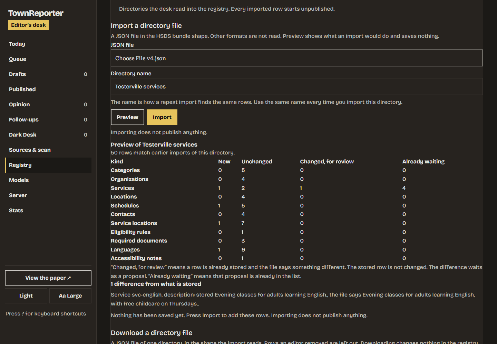
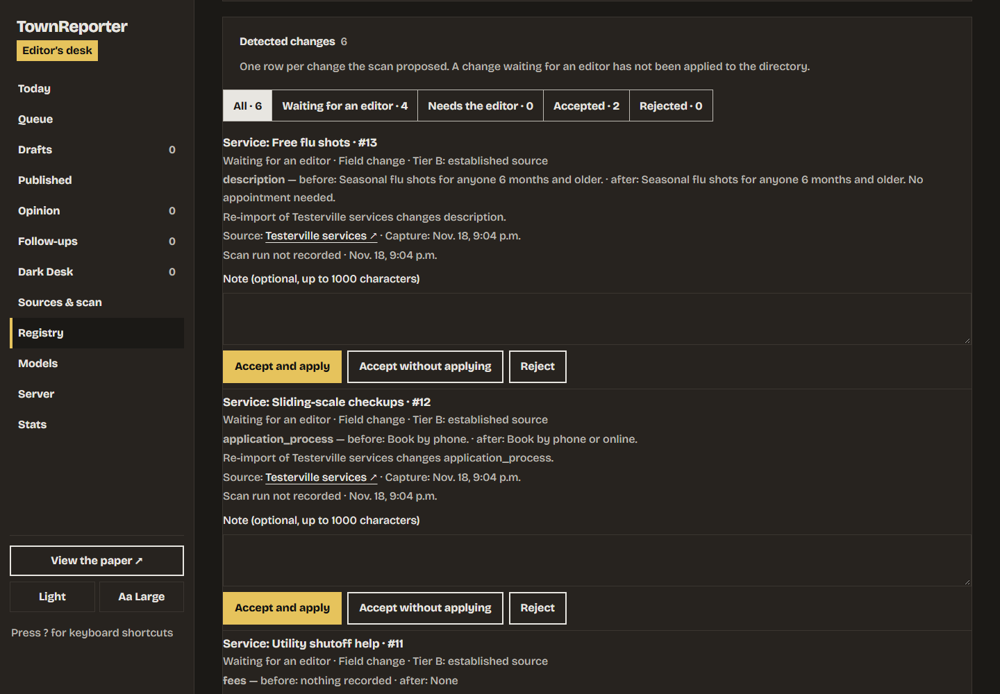

# Import a directory file (HSDS JSON)

This guide is for the desk editor. Use it to read a directory's file into the community resource registry, and to remove and restore rows of an entry afterward. The page is `/desk/registry`, in the **Imports** section.

## What the file must be

- A JSON file that ends in `.json`.
- 8 MB or smaller.
- In the HSDS bundle shape: a top-level object with an `organizations` list. An optional `taxonomies` list holds the categories. Each organization can hold its `services`, `locations` and `phones`. Each service can hold `phones`, `schedules`, `eligibilities`, `required_documents`, `languages`, `accessibilities` and `service_at_locations`.
- Other formats (CSV, XML, a spreadsheet) are not read.

A sample file is in the code at `src/lib/news/registry/__fixtures__/sample-bundle.json`.

## Steps

1. Open `/desk/registry`. Find **Import a directory file** in **Imports**.
2. Under **JSON file**, choose the file.
3. Under **Directory name**, type the name of the directory. The name is how a repeat import finds the same rows. Use the same name every time you import this directory. The box suggests names of earlier imports.
4. Press **Preview**. Preview saves nothing. No row in the registry changes.
5. Read the preview. See "What the counts mean" below.
6. If the panel says **This looks like a new directory.**, no earlier import used this name. If you meant an earlier directory, check the spelling.
7. Press **Import**. **Import** is off until a good preview of exactly this file and this name is on screen. If you change the file or the name, the preview is cleared and you preview again.
8. The panel says **Imported** with the directory name, then **Nothing was published.** The same counts are shown.

## If the file is refused

The panel says **The file could not be used:** and lists each problem. Each problem names the bad record, for example `organizations[2].services[0]: name is missing`. At most 50 problems are listed. Nothing is imported. Fix the file and press **Preview** again.

If the connection fails when you press **Import**, the panel says the import may or may not have finished. Look at the list of imports below the panel before you try again.

## What the counts mean

The table has one row for each kind of record that the file holds.

| Column | Meaning |
|---|---|
| **New** | The file has a row that is not stored. It is added, unpublished. |
| **Unchanged** | The row is stored and the file says the same. |
| **Changed, for review** | The row is stored and the file says something different. The stored row is not changed. The difference becomes a pending proposal. |
| **Already waiting** | The row differs, but the same proposal is already pending. It is not added again. |

Under the table, the panel lists each difference: the kind of record, its id in the file, the field, what is stored, and what the file says. A long list shows the first 100 and counts the rest.

Each import is saved in the list of imports with its date, format and these counts.

## What never happens

- **Nothing is published.** Every imported row starts unpublished and unverified. A reader sees a row only after an editor presses **Publish** on its entry.
- **A stored row is never overwritten.** A difference waits as a proposal in **Detected changes**. A proposal changes the directory only when an editor presses **Accept and apply** on it. See [Review a proposal](#review-a-proposal).
- **The same proposal is not repeated.** A second import of the same file adds no new proposals for differences that are already waiting, or that an editor already accepted or rejected. See [Repeat imports and the import lock](#repeat-imports-and-the-import-lock).
- **A status is not a change** when the file says **unverified** or gives no status.
- **A removed row does not come back.** If an editor removed a row from an entry, an import leaves it removed. It counts as unchanged.
- **A bad file writes nothing.** A failed import is rolled back as a whole.

## Remove and restore a row of an entry

1. On the entry, press **All details**.
2. Find the row. Contacts, places, hours, eligibility rules, required documents, languages and accessibility notes can be removed.
3. Press **Remove**. If other entries share the row, a notice names them first. Then press **Yes, remove**. Press **Keep it** to stop.
4. The row leaves its group and appears in **Removed** at the bottom. A contact, place, hours or language stops showing on the public page at once. An eligibility rule, required document or accessibility note is kept on the desk only and is not shown on the public page. **Publish** skips it.
5. To bring it back, press **Restore** on the row in **Removed**. If the entry is already linked to that place, the restore is refused: **This place is already linked to the entry. Nothing was restored.**

A removal is a marker. Nothing is deleted. Removing a place removes this entry's link to the place. The place itself stays, because other entries can use it. Hours at a place the entry is no longer linked to are not published. The editor shows them, read-only, under the note **These hours belong to a place that is no longer linked; they come back if the place is restored.** They come back when the link is restored.

## Review a proposal

Open `/desk/registry` and find **Detected changes**. Use the filters **Waiting for an editor** and **Needs the editor** to see the changes that wait. Each one has a **Note** box (optional, up to 1000 characters) and three buttons:

- **Accept and apply** puts the proposed value on the entry, and marks the proposal accepted.
- **Accept without applying** marks the proposal accepted. The entry does not change. Use it when you will edit the entry yourself.
- **Reject** marks the proposal rejected. The entry does not change.

A proposal that the scan marked **Needs the editor** (a crisis resource) has the same three buttons.

Some proposals cannot be applied:

- **Stale.** The field no longer holds the value the proposal was made against. The row says **This field now says** and **The proposal expected**. **Accept and apply** is not shown, and the server refuses it. **Accept without applying** and **Reject** still work.
- **No target.** The proposal does not point at one live row. It may be a new entry, or a row that was removed. The row says the proposal cannot be applied. Only **Accept without applying** and **Reject** are shown.
- **Value refused.** The field cannot hold the proposed value. **Accept and apply** is refused, and the page says **The proposed value cannot be stored in that field.** Nothing changes.

A proposal that is already accepted or rejected cannot be decided again. The page says who decided it and when, and nothing changes. Accepting never verifies an entry. Each accept and each reject writes one audit record.

## Repeat imports and the import lock

- An import does not propose again a change that an editor already accepted or rejected. The match covers the field, the row, the value the file gives and the value the entry holds now. If the entry changed after the decision, the change can be proposed again.
- Each import takes a lock for one newsroom and one directory name. A second import of the same directory waits until the first one finishes. It then sees the first import's proposals, so it does not repeat them. A preview takes the same lock.

## Download a directory file

The desk can save one directory as a JSON file. The button is **Download directory file**. It is in the **Imports** section of `/desk/registry`, under the import panel, with one button for each directory that has been imported.

- **Who can use it:** a signed-in owner or editor of the newsroom. Others are refused.
- **What the file holds:** the directory in the shape the import reads (see "What the file must be"). It holds every row of the directory, published or not, except the rows an editor removed. Removed rows are left out.
- **The file name:** `directory-<name>-<date>.json`. The name is the directory name in lower case, with only letters, digits and hyphens, up to 80 characters. The date is the day of the download, by the server's own clock and time zone. For example: `directory-example-hsds-directory-2026-11-18.json`.
- **Nothing changes.** Downloading writes nothing to the registry and publishes nothing.
- **If it fails.** A directory with no rows in this newsroom gives **That directory is not in this newsroom. Nothing was changed.** A file that cannot be made gives **The file could not be made. Nothing was changed.**

The file is a copy for keeping, or for moving a directory to another desk. It is not a certified HSDS export. Imported back into the same newsroom and directory, it adds no rows and no proposals. Imported into an empty newsroom, it brings back the rows with the fields the import needs.

## Back up and restore the community directory

The directory is part of the whole-database backup. There is no separate directory backup. The nightly backup (`ops/backup.ps1`) is one `pg_dump` of the whole database, and one restore brings the directory back with everything else.

These tables hold the directory and its review record:

- `organizations`, `services`, `locations`, `service_at_locations`, `schedules`, `contacts` (phones and emails), `eligibilities`, `required_documents`, `languages`, `accessibilities`
- `resource_sources` (which source backs which entry), `resource_imports`
- `taxonomies` (the categories)
- `sources` (the source links that entries point to; the newsroom's own source table, shared with its other sources)
- `resource_changes` (proposals, with review state, note and applied time)
- `resource_verifications` (the verification snapshots)
- `audit_events`

To restore, follow the restore steps in `docs/staging.md` (`ops/stage.ps1` restores a backup into a fresh database with `psql`). Then check the restore log for SQL errors, as `docs/HALO-UPDATE-0.6.35.md` says.

What was shown: on 2026-11-18 a small directory was dumped with the same command the backup uses (`pg_dump -p <port> -U postgres -d <db> -f <file>`) and restored with `psql -f` into a fresh database, on a throwaway Postgres 18.6 that held no live data. The restore log had no errors. The two databases matched on row counts for every table in the list as it stood that day, published flags, removed markers, sources, the links from service to organization and place, review state, note and applied time, the verification snapshot, and the audit rows. `taxonomies` and `sources` were added to the list after that check. Not checked: whether that check covered them. The directory was seeded by SQL on a database migrated to 0166, not imported from a file. The nightly job itself, `pg_restore`, and the size and timing of a real backup were not checked.

## Not yet

Sending a proposal back for another look is not built. A public search and a public JSON feed were added in Phase 4; see [registry-api.md](registry-api.md).
