# Community resources API, version 1

The community resources directory has a public, read-only JSON API. It answers for this paper's directory. It needs no sign-in, and the answer is the same for everyone. It accepts only GET.

The API returns what `/registry` shows: published, active services under published, active organizations. It never returns drafts, unpublished or inactive entries, rows an editor removed, or another newsroom's entries. It never sends the verification basis, who made a check, review notes, audit data or a contact person's name. It does not read cookies or authorization headers, so signing in changes nothing.



*How a directory entry gets from an import file to the public pages and this feed.*

## Routes

| Route | Returns |
|---|---|
| `GET /api/registry/v1/services` | A page of published services. Takes the search and filters below. |
| `GET /api/registry/v1/services/<id>` | One published service, by its id. |
| `GET /api/registry/v1/categories` | The categories that at least one published service is filed under. |

Put the paper's own address in front of these paths, for example `https://<your-paper-address>/api/registry/v1/services`. A trailing slash is accepted. Any other path under `/api/registry/v1` gives 404 `not_found`.

## Parameters

### `/services`

| Parameter | What it does | Limits |
|---|---|---|
| `q` | Matches the service name, the organization name, the description or the category name, in any capitals. `%` and `_` match as plain characters. | Up to 200 characters, after leading and trailing spaces are removed. A longer value gives 400 `bad_parameter`. The `/registry` page cuts a longer search to 200 instead. |
| `category` | Only services in this category. Use an `id` from `/categories`. | A positive whole number. An empty value is the same as no filter. |
| `language` | Only services that list this language. The value must equal a language on the service, without regard to capitals. Part of a name does not match. | Up to 100 characters. An empty value is the same as no filter. Use a value from a service's `languages`. |
| `page` | Which page, counting from 1. | A whole number from 1 to 100000. Default 1. An empty value gives 400. |
| `limit` | Services per page. | A whole number from 1 to 100. Default 25. An empty value gives 400. |

A null character (`%00`) in `q` or `language` gives 400 `bad_parameter`.

Services come in this order: category name (services with no category come last), then organization name, then service name, then id.

### `/services/<id>`

`<id>` is the service's `id` from a list. A value that is not a whole number gives 400 `bad_parameter`. A whole number that is 0, too large, or not a published service gives 404 `not_found`.

### `/categories`

No parameters.

## Envelope

Every body is JSON, and its first field is `"version": "1"`.

A list of services:

```
{ "version": "1", "data": [ ... ], "page": { "number": 1, "size": 25, "total": 3 } }
```

- `page` appears on the services list only.
- `number` is the page asked for. `size` is the number of services per page. `total` is the number of services that match across all pages.
- The detail route returns one service object as `data`. The categories route returns a list.
- An empty result is 200 with `"data": []`. A page past the end is also 200 with `"data": []`, and `total` still counts every match.

An error:

```
{ "version": "1", "error": { "code": "bad_parameter", "message": "limit must be a whole number from 1 to 100." } }
```

## Error codes

| Status | Code | When |
|---|---|---|
| 400 | `bad_parameter` | A parameter is outside its limits, or a service id is not a whole number. |
| 404 | `not_found` | An unknown path, or a service id that is unknown, unpublished or not listed. |
| 405 | `method_not_allowed` | Any method other than GET. The response includes `allow: GET`. |
| 503 | `unavailable` | The directory could not be read. Try again shortly. The message has no stack and no database text. The cause goes to the server log only. |

## Headers

| Header | Value | Sent |
|---|---|---|
| `content-type` | `application/json; charset=utf-8` | Every response |
| `access-control-allow-origin` | `*` | Every response, so a web page on another site can read it |
| `cache-control` | `public, max-age=60` | Successful responses |
| `cache-control` | `no-store` | Every error. A failed read is not kept, because the next try may work. |
| `allow` | `GET` | 405 responses |

## Service fields

Each service object has these fields. `null` or `[]` means the entry has no such detail.

| Field | Meaning |
|---|---|
| `id` | The service's id. The same number is in `/services/<id>` and in the page address `/registry/<id>`. |
| `hsds_id` | The id the directory gave the service. |
| `directory` | The name of the directory the service came from. Empty when an editor entered it by hand. |
| `name`, `description` | The service's name and description. |
| `status` | Always `active` for a listed service. |
| `organization` | `{ name, phones }`: the organization's name and its main phones. |
| `category` | `{ id, name }`, or `null`. |
| `fees`, `application_process`, `url` | Fees, how to apply, and the service's own website. |
| `emails`, `phones`, `hours` | The service's own emails, phones and hours, not tied to one place. |
| `languages` | The languages the service offers. |
| `eligibility` | Who can use the service, as text. |
| `required_documents` | `[{ document, description, required }]`. |
| `accessibility` | Accessibility notes for the whole service. |
| `locations` | `[{ id, name, address, phones, hours, accessibility }]`, one item for each place. A place's phones, hours and accessibility belong to that place only. |
| `sources` | `[{ url, title, applies_to }]`. `applies_to` is `service`, or `organization` when the organization's source is a different page. |
| `verification` | `{ verified_at, method }` for the latest check an editor recorded, or `null`. `method` is one of `phone`, `website`, `visit`, `email`, `document`, `organization`. |
| `last_updated_at` | A date that a save or publish set before checks were recorded. It is not a check. |
| `editor_note` | The service's editor note, or the organization's note when the service has none. |

Dates are ISO 8601 text in UTC. Hours are text, for example `Tuesday, 10:00–12:00`, or `By appointment`.

## Examples

The field names and their order come from the code. The values in these examples are made up for this page.

### Services: `GET /api/registry/v1/services?q=food&limit=1`

```json
{
  "version": "1",
  "data": [
    {
      "id": 12,
      "hsds_id": "svc-0412",
      "directory": "example-directory",
      "name": "Weekly food pickup",
      "description": "Groceries for households that sign up each week.",
      "status": "active",
      "organization": {
        "name": "Example Food Pantry",
        "phones": ["555-0100"]
      },
      "category": { "id": 3, "name": "Food" },
      "fees": null,
      "application_process": "Call ahead or come to the front desk.",
      "url": "https://example.org/food",
      "emails": ["pantry@example.org"],
      "phones": ["555-0101"],
      "hours": ["Tuesday, 10:00–12:00"],
      "languages": ["English", "Spanish"],
      "eligibility": ["Open to all residents"],
      "required_documents": [
        { "document": "Photo ID", "description": null, "required": false }
      ],
      "accessibility": [],
      "locations": [
        {
          "id": 7,
          "name": "Main hall",
          "address": "1 Main St, Example Town",
          "phones": ["555-0102"],
          "hours": ["Tuesday, 10:00–12:00"],
          "accessibility": ["Step-free entrance"]
        }
      ],
      "sources": [
        { "url": "https://example.org/food", "title": "Food pantry page", "applies_to": "service" }
      ],
      "verification": { "verified_at": "2026-11-10T16:00:00.000Z", "method": "phone" },
      "last_updated_at": "2026-11-10T16:00:00.000Z",
      "editor_note": null
    }
  ],
  "page": { "number": 1, "size": 1, "total": 3 }
}
```

### One service: `GET /api/registry/v1/services/19`

```json
{
  "version": "1",
  "data": {
    "id": 19,
    "hsds_id": "svc-0019",
    "directory": "example-directory",
    "name": "Rent help line",
    "description": null,
    "status": "active",
    "organization": { "name": "Example Housing Office", "phones": [] },
    "category": { "id": 5, "name": "Housing" },
    "fees": "Free",
    "application_process": null,
    "url": null,
    "emails": [],
    "phones": ["555-0190"],
    "hours": ["By appointment"],
    "languages": [],
    "eligibility": [],
    "required_documents": [],
    "accessibility": [],
    "locations": [],
    "sources": [
      { "url": "https://example.org/housing", "title": "Housing office", "applies_to": "organization" }
    ],
    "verification": null,
    "last_updated_at": null,
    "editor_note": "Calls are answered on weekdays."
  }
}
```

### Categories: `GET /api/registry/v1/categories`

```json
{
  "version": "1",
  "data": [
    { "id": 3, "name": "Food" },
    { "id": 5, "name": "Housing" }
  ]
}
```

## Compatibility

Version 1 is a promise. Fields are only added. A field is never renamed or removed in version 1. A change that would break a reader of version 1 comes as version 2 at a new path. Readers should ignore fields they do not recognise, so added fields do not break them.

## Read only

The API takes no writes. Any method other than GET gets 405.
