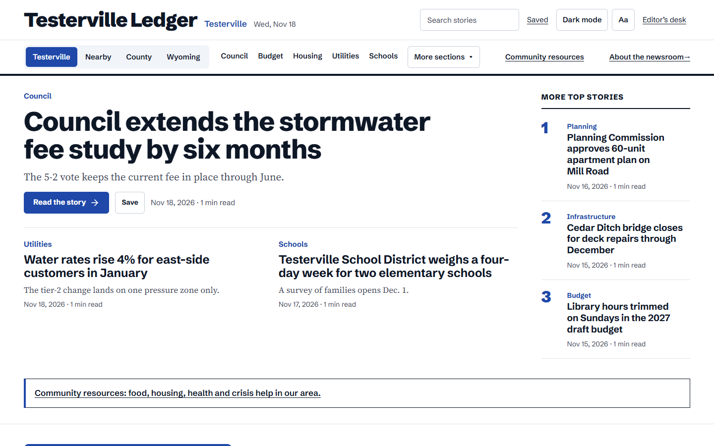
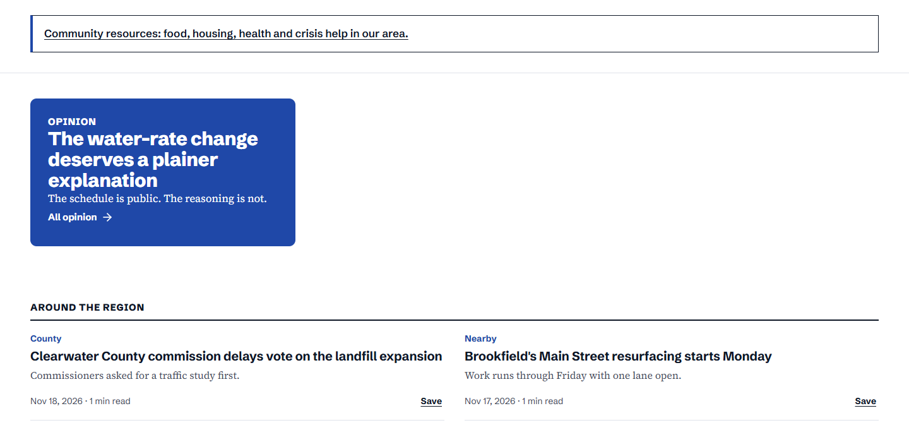
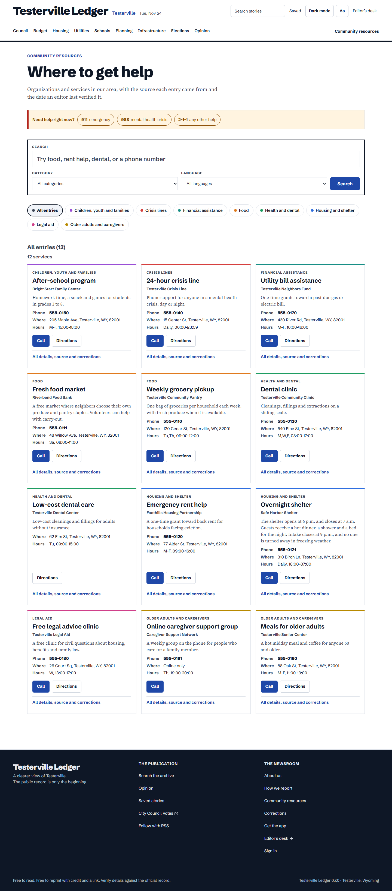
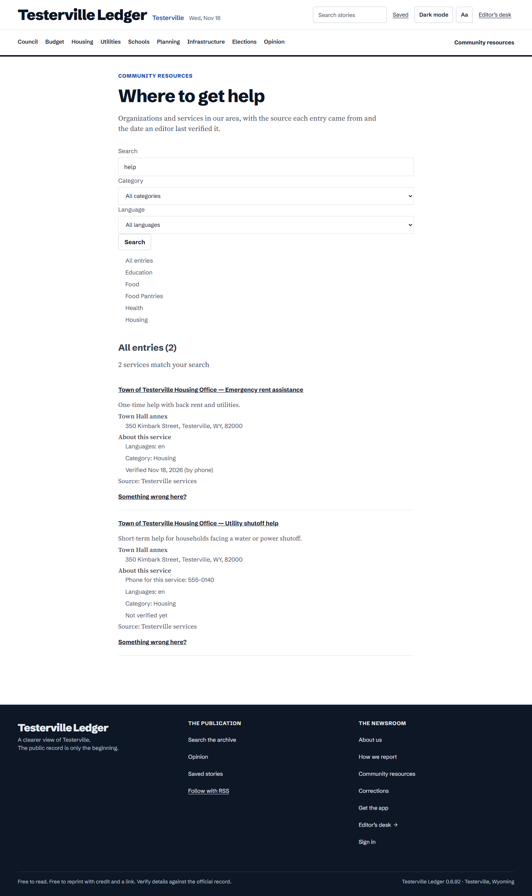
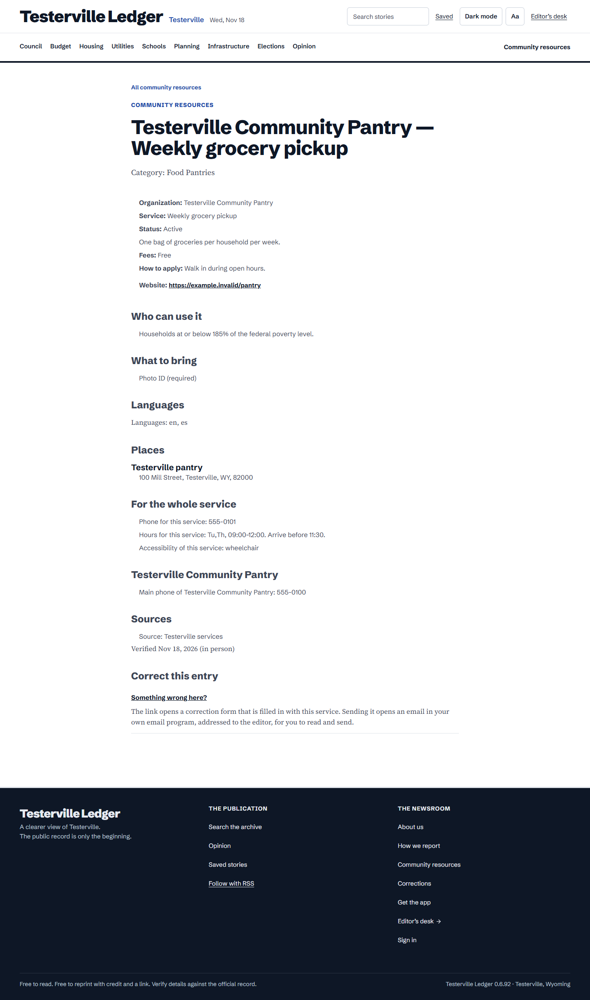
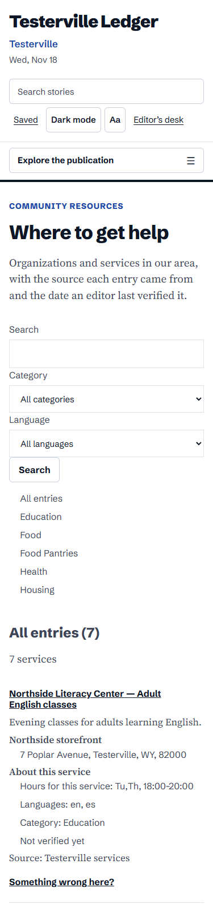
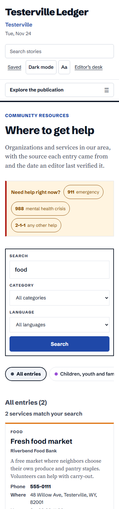

# Reading TownReporter

For TownReporter 0.8.0. This guide is for readers of the public paper. You need no account, no app and no cookie banner. The paper uses its own name, town and sections, which its owner sets.

## The top of every page

The masthead carries the paper’s name and the section links. Select the paper’s name to return to the front page from any page. On the front page, small links under the name (the town, **Nearby**, the county and the state) choose which ground to read, and the section links run across below. On a narrow screen, **Explore the publication** opens the section menu. **About the newsroom →** goes to the About page.

The top controls include:

- **Search stories** opens the archive.
- **Saved** (with a number once you have saved stories) opens your reading list.
- **Dark mode** / **Light mode** switches the look in one press. The button names the look you will get.
- **Aa Text size** opens **Reading preferences**.
- **Editor’s desk** opens the newsroom’s desk for a signed-in editor and the sign-in page for everyone else. Readers can ignore it.

## The front page

The front page has these parts:

- **The events week box**, near the top above the lead. It shows when the week has events. It says **From approved public calendars.** and lists **Roundups**.
- **Top stories**, the lead area, with the lead and recent stories.
- A river of newer stories.
- **Roundups**, with links to the paper’s roundups.
- An **Opinion** panel with the paper’s newest editorial and **All opinion →**.
- **More top stories**, the way to more stories.

The lead story has its section, headline, a line of summary, the date and a read time, and **Read the story →**. Under it sit one or two more recent stories.

The events week box shows **TODAY** plus the next six days, each with an event count. Today is picked when the box opens. Select a day to see four columns: **MORNING**, **AFTERNOON** and **EVENING** for the home town, then **NEARBY** with the town on each line. Each column shows two lines, then a count of more. The **All** link with the event count opens the **Today in town** story for today when there is one. For other days it opens the full list inside the box. An empty day says **No events listed for** that weekday. A week with no events shows no box. On a phone the day strip scrolls sideways and the columns stack.

Event titles link only to a real event page. Broken characters are fixed, and repeated or junk titles are removed. Each event shows its feed description when the feed has one.

The front page does not scroll on forever. **More top stories** is the way to more stories.

## Find and save stories

The archive (**Search stories** in the masthead, **Search the archive** in the footer) is titled **Find a story.** Type a name, a place or a phrase into **Search stories, names or places** and press **Search**. Words in the headline and summary are matched, and the story text too once you type three or more letters. It matches the letters you type, not their meaning. **Section** and **Sort** (**Newest first** / **Oldest first**) narrow the list. Twelve stories show per page, with **Previous** and **Next →**. If nothing matches, the page offers **Front page** and **Clear filters**. Every older story address and section link still works.

The **Save** button beside any story adds it to **Saved**. It reads **Saved** once saved. Press it again to remove it. Up to 500 stories stay in this browser for this paper. They do not sync between devices, and a story that is later unpublished drops out of your list. Your reading list is at **Saved** and needs no account.

## Text size and appearance

**Aa Text size** (and **Reading preferences** on a story) opens **Make yourself comfortable.** Choose **Normal** or **Large** story text and **Light** or **Dark** for the page, then **Done**. Preferences stay in this browser. Until you choose, the page follows your device’s light or dark setting.

## A story page

- **The top:** a trail back to the front page and the section, the headline, a line of summary, the paper’s name, the date and the read time. There is no person’s byline. Buttons: **Save**, **Share ↗** and **Aa Text size**.
- **In this article** lists jump links: **The story**, **Claims and sources** (opinion pieces and others that have an appendix), **Sources & records**, **Corrections** and **Read next**.
- **Dates in this story** is a box of dates found in the story’s records. It is not shown on the daily “Today in town” roundup.
- **How we reported this** (the **Follow the evidence** band) shows each source: its title, who published it, the document date and when the paper captured it. **Current source** opens the original page. **View captured version** opens the paper’s saved copy; **Compare versions** appears when a record was captured more than once. If the original has disappeared, the card says so and the saved copy remains.
- **Corrections & accountability** shows every correction on the story, each with its date, or says none have been posted. **File a correction →** takes you to the Corrections page with this headline filled in.
- **Share the reporting.** Stories are free to reprint with credit and a link. **Copy credit & original link** copies the headline, “Originally published by <paper>” and the address. **Share ↗** opens **Share this story** with **Copy story link →**. If your browser blocks copying, a box shows selectable text.
- **Keep reading** offers up to three other recent stories and **More in this section →**.

**View captured version** shows a short excerpt of the paper’s copy, when it was captured, a content fingerprint and a prominent link to the original. The paper keeps the full capture for its own records and does not republish another outlet’s article. If a publisher asked for an excerpt to be taken down, the page says so.

**Opinion pieces** carry the section tag **Opinion** and “OPINION:” at the front of the headline. They have no byline, and their sources appear in a **Claims and sources** appendix at the end.

**Today in town, This weekend and Deadlines approaching** are routine roundups the paper prints from approved public calendars. **Today in town** lists the day’s events in time order (under **Morning**, **Afternoon** and **Evening** when there are six or more), then a **Source:** link to the calendar it came from. On a same-day change to the paper’s own roundup, the list, summary and source links update. The story then carries a short note: “The list in this story was updated. N new items were added.”

## Community resources

**Community resources** is in the top menu on desktop and mobile, and in one line on the front page. The footer link stays. It opens `/registry`.

The search and filters, the page for each service, the **Something wrong here?** link, the per-place phone and hours, and the check lines below are in 0.7.0. The card layout described next is in 0.7.1.

The page is titled **Where to get help**. It uses the full width of the screen. At the top, a row gives **911**, **988** and **2-1-1**. On a phone, each one is a button that starts the call. The page lists only published entries, as cards.

**A card.** Each card shows the category, the service name (select it to open the service’s own page), the organization, a short description, and three facts: **Phone**, **Where** and **Hours**. A card shows only the facts the entry has. **Call** starts a call to the first phone number. **Directions** opens a map for the address, and shows only when the address starts with a street number. **All details, source and corrections** opens the rest of the entry. It lists each place where the service is offered under its own name, with its own address, **Phone at this location:** and **Hours at this location:**. Below the places, under **About this service**, come **Phone for this service:** and **Hours for this service:** (not tied to one place), **Main phone of** the organization (labeled as the organization’s, not a place’s), **Languages:**, **Category:**, the check line, an editor’s note, and a **Source:** link. **Something wrong here?** is in there too.

**Search and filters.** Type a name, a place or a word in **Search**. The results change as you type, after a short pause, and the page does not reload. A moving bar and grey placeholder cards show that the page is searching. You can also press **Search**, and that works with JavaScript turned off. The search looks at the service name, the organization name, the description and the category name, in any capitals. It takes up to 200 characters. The category chips, **Category** and **Language** narrow the list. A chip’s color shows its group of needs, such as food, housing, health or crisis help. On a phone the chips scroll sideways. The **Language** list shows the languages that published services offer. The page says how many services there are, or how many match your search. It shows 25 services to a page. When there is more than one page, it says which page you are on, and **Next page** and **Previous page** move you through them. The list is in order by category (services with no category come last), then by organization and service name. If nothing matches, the page says **No services match your search.** and offers **Clear the search**.

**Each service has its own page.** Select a service’s name to open it. Its address is `/registry/` followed by the service’s number, so you can keep or share it. The page shows the public details the entry has, and leaves out the ones it does not have. Contact people’s names are not shown. If the address is not a published service, the page says **This service is not listed.** It may have been removed, or the address may be wrong. A link takes you back to the list.

**Something wrong here?** is on the list and on each service’s page. It opens **Corrections** with the entry’s name, its number and its web address already in the form. Press **Open correction email →** to prepare a message to the editor. Review it and press Send in your own email app. The website sends nothing itself. If the paper has not set an editor address, the page says so, and no message is prepared.

Use **All entries** and the category links to browse. If nothing is published, the page says **No entries are published yet.** and explains that TownReporter adds entries after an editor checks them. If a category has no entries but others do, the page says so and links to **See all entries**. If the page cannot read the list, it says the list could not be loaded, and gives a **Try again** link that keeps your search, category and language; it does not say nothing is published.

The page says **Verified** with a date and how the check was made, such as by phone, only when an editor recorded a check. A date that only a save or publish set reads **Last updated** with that date, then **Not verified yet.** An entry with neither reads **Not verified yet**. Change detection is not verification. It never says a program is confirmed open.

**On a phone** the cards stack in one column. **Call** is a full-width button, **Directions** sits under it, and the 911, 988 and 2-1-1 buttons stay at the top.

## Get the paper on your phone

On a phone, a story page shows an install bar at the top. It shows once. **Close** dismisses it. If the browser can install the paper, the bar has **Install**. On iPhone it shows the Share button and **“Add to Home Screen”**, with **See all steps**. On Android it shows how to add the paper from the browser menu, with **See how**.

**Get the app** at `/get-the-app` gives full steps for **iPhone or iPad** and **Android**. No app store. Nothing to pay. If the paper already runs from your home screen, the page says **You already have the app.** The **Install** button appears only where the browser has a prompt to show.

The paper registers `/sw.js` after page load. The service worker caches nothing. When the phone is offline, it answers page loads with “You are offline.”

## Request a correction

Select **File a correction →** on a story, or **Corrections** in the footer. The page is titled **Getting it right includes putting it right.** Fill in what needs correcting (required) and optionally the story’s headline or link, a supporting source, your name and a reply email. Your text stays in this tab after navigation or reload.

**Open correction email →** prepares a message to the address the paper’s owner set as the **Editor contact email** (the same address shown on the About page). Review and send it in your own email app. The website does not send email itself and never claims it did: “This page has not sent your correction.” If no email app is set up, copy the text and write to the address shown. If the paper has not set an address, the page says so. Under the form, **Corrections to published stories** lists the newest 50 public corrections with their dates, each linking back to its story. Your email is not published automatically.

## Follow the paper

- **Follow with RSS** in the footer opens **New stories, in your reader.** with the feed address (`/feed`), **Copy feed address** and **Open feed ↗**. The feed carries the newest 40 stories with their headlines, links, dates and a summary line.
- **About us** and **How we report** in the footer explain who runs the paper and how it works, in plain words.
- The footer ends with the paper’s name, the TownReporter version and the location.

## Your privacy

The paper uses no cookies and no accounts and loads no outside scripts or fonts. It counts visits in total, never per person. Readers are never asked to sign in.
